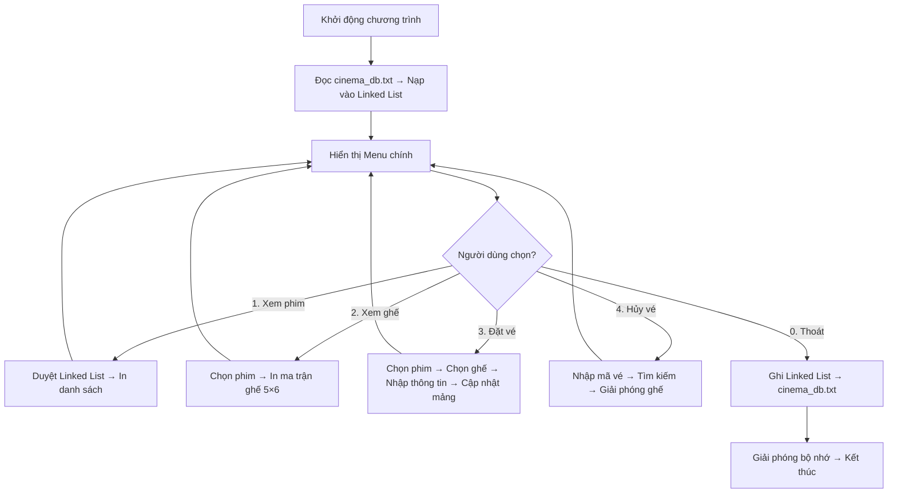
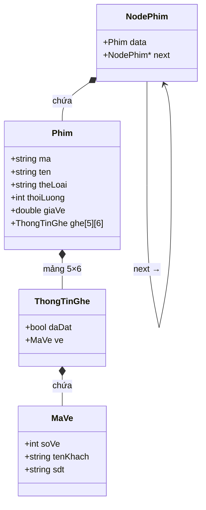
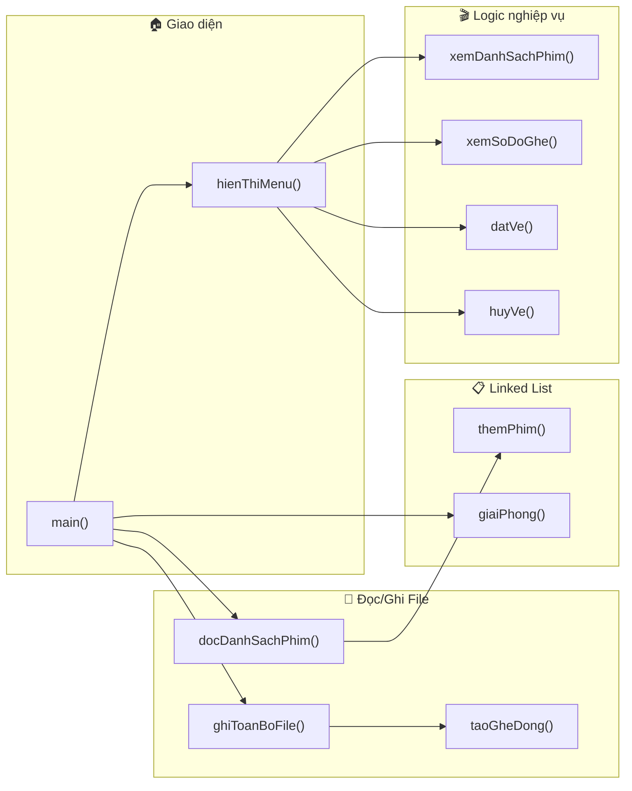
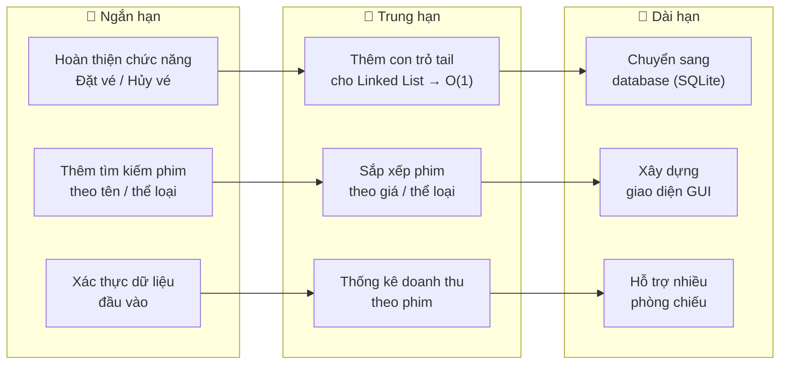

# BÁO CÁO TIỂU LUẬN
## HỆ THỐNG QUẢN LÝ ĐẶT VÉ XEM PHIM (Movie Booking System)

---

## MỤC LỤC

1. [Giới thiệu đề tài](#1-giới-thiệu-đề-tài)
2. [Phân tích yêu cầu và mô tả giải pháp](#2-phân-tích-yêu-cầu-và-mô-tả-giải-pháp)
3. [Thiết kế cấu trúc dữ liệu và mô hình chương trình](#3-thiết-kế-cấu-trúc-dữ-liệu-và-mô-hình-chương-trình)
4. [Một số đoạn mã quan trọng (có chú thích)](#4-một-số-đoạn-mã-quan-trọng-có-chú-thích)
5. [Hình ảnh minh họa (chạy chương trình)](#5-hình-ảnh-minh-họa-chạy-chương-trình)
6. [Nhận xét và hướng phát triển thêm](#6-nhận-xét-và-hướng-phát-triển-thêm)

---

## 1. Giới thiệu đề tài

### 1.1. Bối cảnh

Trong bối cảnh ngành công nghiệp giải trí ngày càng phát triển, nhu cầu quản lý và đặt vé xem phim tại các rạp chiếu phim trở nên cấp thiết. Một hệ thống đặt vé hiệu quả không chỉ giúp rạp phim quản lý lịch chiếu, sơ đồ ghế ngồi mà còn mang lại sự tiện lợi cho khách hàng khi đặt vé.

### 1.2. Mục tiêu đề tài

Xây dựng **Hệ thống Quản lý Đặt vé Xem phim** (Movie Booking System) bằng ngôn ngữ **C++**, sử dụng các cấu trúc dữ liệu cơ bản nhằm:

- **Quản lý danh sách phim** đang chiếu tại rạp (mã phim, tên phim, thể loại, thời lượng, giá vé).
- **Quản lý sơ đồ ghế ngồi** cho từng phim (30 ghế, bố trí 5 hàng × 6 cột).
- **Đặt vé / hủy vé** cho khách hàng, ghi nhận thông tin (tên, số điện thoại, mã vé tự động).
- **Lưu trữ dữ liệu** xuống file cơ sở dữ liệu (`cinema_db.txt`) để dữ liệu được bảo toàn giữa các lần chạy.

### 1.3. Công nghệ sử dụng

| Thành phần | Công nghệ / Công cụ |
| :--- | :--- |
| Ngôn ngữ lập trình | C++ (chuẩn C++11 trở lên) |
| Cấu trúc dữ liệu chính | **Danh sách liên kết đơn** (Singly Linked List), Mảng 2 chiều (Matrix) |
| Lưu trữ dữ liệu | File text (`cinema_db.txt`) — định dạng tùy chỉnh |
| Trình biên dịch | g++ (MinGW / GCC) |
| Quản lý mã nguồn | Git & GitHub |

### 1.4. Phạm vi đề tài

- Chương trình chạy trên **giao diện dòng lệnh** (Console / Terminal).
- Dữ liệu được lưu trữ dưới dạng file text thay vì sử dụng hệ quản trị cơ sở dữ liệu.
- Phục vụ cho mục đích học tập, thực hành cấu trúc dữ liệu (Linked List, mảng 2D, struct, con trỏ).

---

## 2. Phân tích yêu cầu và mô tả giải pháp

### 2.1. Yêu cầu chức năng

| STT | Chức năng | Mô tả |
| :---: | :--- | :--- |
| 1 | **Xem danh sách phim** | Hiển thị tất cả các phim đang chiếu kèm thông tin: mã phim, tên, thể loại, thời lượng, giá vé. |
| 2 | **Xem sơ đồ ghế** | Hiển thị sơ đồ 5×6 = 30 ghế của một phim cụ thể, phân biệt ghế trống và ghế đã đặt. |
| 3 | **Đặt vé** | Khách chọn phim → chọn ghế trống → nhập tên và SĐT → hệ thống tạo mã vé tự động, đánh dấu ghế đã đặt. |
| 4 | **Hủy vé** | Nhập mã vé → hệ thống tìm kiếm và giải phóng ghế tương ứng, xóa thông tin khách. |
| 5 | **Lưu / đọc dữ liệu** | Khi khởi động: đọc toàn bộ dữ liệu từ `cinema_db.txt` vào RAM. Khi thoát: ghi toàn bộ dữ liệu ngược lại file. |

### 2.2. Yêu cầu phi chức năng

- **Tính nhất quán**: Dữ liệu trên RAM và trên file phải đồng bộ khi thoát chương trình.
- **Dễ bảo trì**: Mã nguồn chia thành các hàm / module rõ ràng, có chú thích đầy đủ.
- **Hiệu năng**: Sử dụng Linked List cho phép thêm/xóa phim linh hoạt mà không cần cấp phát mảng cố định.

### 2.3. Giải pháp tổng quan



---

## 3. Thiết kế cấu trúc dữ liệu và mô hình chương trình

### 3.1. Sơ đồ cấu trúc dữ liệu (Struct Hierarchy)

Chương trình sử dụng 4 struct lồng nhau và 1 danh sách liên kết đơn:



### 3.2. Chi tiết từng cấu trúc dữ liệu

#### 3.2.1. `MaVe` — Thông tin vé

| Trường | Kiểu | Ý nghĩa |
| :--- | :--- | :--- |
| `soVe` | `int` | Mã số vé (bắt đầu từ 1001, tự tăng). Giá trị `0` = chưa đặt. |
| `tenKhach` | `string` | Họ tên khách hàng |
| `sdt` | `string` | Số điện thoại khách hàng |

#### 3.2.2. `ThongTinGhe` — Trạng thái một ô ghế

| Trường | Kiểu | Ý nghĩa |
| :--- | :--- | :--- |
| `daDat` | `bool` | `false` = ghế trống, `true` = đã có người đặt |
| `ve` | `MaVe` | Thông tin vé (chỉ có nghĩa khi `daDat == true`) |

#### 3.2.3. `Phim` — Thông tin một bộ phim

| Trường | Kiểu | Ý nghĩa |
| :--- | :--- | :--- |
| `ma` | `string` | Mã phim (VD: `"P01"`) |
| `ten` | `string` | Tên phim (VD: `"Avatar: The Way of Water"`) |
| `theLoai` | `string` | Thể loại (VD: `"Hanh Dong"`) |
| `thoiLuong` | `int` | Thời lượng (phút) |
| `giaVe` | `double` | Giá vé mỗi ghế (VND) |
| `ghe[5][6]` | `ThongTinGhe[][]` | Ma trận sơ đồ 30 ghế (5 hàng A→E × 6 cột 1→6) |

#### 3.2.4. `NodePhim` — Node của Linked List

| Trường | Kiểu | Ý nghĩa |
| :--- | :--- | :--- |
| `data` | `Phim` | Dữ liệu phim chứa bên trong node |
| `next` | `NodePhim*` | Con trỏ trỏ đến node phim tiếp theo |

### 3.3. Mô hình Linked List trong bộ nhớ

```
headPhim ──→ [Phim P01] ──→ [Phim P02] ──→ [Phim P03] ──→ [Phim P04] ──→ nullptr
              │                │                │                │
              ▼                ▼                ▼                ▼
           ghe[5][6]       ghe[5][6]       ghe[5][6]       ghe[5][6]
           (30 ghế)        (30 ghế)        (30 ghế)        (30 ghế)
```

### 3.4. Sơ đồ ghế (Ma trận 5×6)

```
         Cột 1    Cột 2    Cột 3    Cột 4    Cột 5    Cột 6
Hàng A  ghe[0][0] ghe[0][1] ghe[0][2] ghe[0][3] ghe[0][4] ghe[0][5]   → Ghế 01–06
Hàng B  ghe[1][0] ghe[1][1] ghe[1][2] ghe[1][3] ghe[1][4] ghe[1][5]   → Ghế 07–12
Hàng C  ghe[2][0] ghe[2][1] ghe[2][2] ghe[2][3] ghe[2][4] ghe[2][5]   → Ghế 13–18
Hàng D  ghe[3][0] ghe[3][1] ghe[3][2] ghe[3][3] ghe[3][4] ghe[3][5]   → Ghế 19–24
Hàng E  ghe[4][0] ghe[4][1] ghe[4][2] ghe[4][3] ghe[4][4] ghe[4][5]   → Ghế 25–30
```

**Công thức chuyển đổi** giữa số ghế `i` (1–30) và tọa độ mảng:
```
r = (i - 1) / 6       (hàng, 0-indexed)
c = (i - 1) % 6       (cột,  0-indexed)
```

### 3.5. Định dạng File Database (`cinema_db.txt`)

```
#<MaPhim>|<TenPhim>|<TheLoai>|<ThoiLuong>|<GiaVe>      ← Header phim
01|O                                                      ← Ghế 01, trống
02|O                                                      ← Ghế 02, trống
03|X|1001|Nguyen Van A|0912345678                         ← Ghế 03, đã đặt
...
30|O                                                      ← Ghế 30, trống
#<MaPhim>|...                                             ← Phim tiếp theo
```

### 3.6. Mô hình chức năng (Function Map)



---

## 4. Một số đoạn mã quan trọng (có chú thích)

### 4.1. Khai báo cấu trúc dữ liệu (Struct)

```cpp
// Hằng số quy định kích thước sơ đồ ghế
const int SO_HANG = 5;          // 5 hàng: A → E
const int SO_COT  = 6;          // 6 cột:  1 → 6
const int TONG_GHE = SO_HANG * SO_COT;  // Tổng = 30 ghế / phim

// ── Struct lồng nhau ──────────────────────────────────────

// MaVe: lưu thông tin vé đặt vào một ô ghế
struct MaVe {
    int    soVe;      // Mã vé (0 = chưa đặt, ≥1001 = đã đặt)
    string tenKhach;  // Tên khách hàng
    string sdt;       // Số điện thoại
};

// ThongTinGhe: trạng thái + thông tin vé của 1 ô ghế
struct ThongTinGhe {
    bool  daDat;      // false = trống, true = đã đặt
    MaVe  ve;         // Thông tin vé đi kèm
};

// Phim: thông tin 1 bộ phim + toàn bộ sơ đồ 30 ghế
struct Phim {
    string       ma;                    // Mã phim (VD: "P01")
    string       ten;                   // Tên phim
    string       theLoai;               // Thể loại
    int          thoiLuong;             // Thời lượng (phút)
    double       giaVe;                 // Giá vé (VND)
    ThongTinGhe  ghe[SO_HANG][SO_COT]; // Ma trận ghế 5×6
};

// NodePhim: node của Linked List chứa 1 phim
struct NodePhim {
    Phim      data;   // Dữ liệu phim
    NodePhim* next;   // Con trỏ sang node kế tiếp
};
```

> **Giải thích**: Thiết kế struct lồng nhau giúp tổ chức dữ liệu phân cấp rõ ràng. Mỗi `NodePhim` chứa trọn vẹn thông tin 1 phim bao gồm cả sơ đồ 30 ghế ngồi, tạo thành một linked list các phim.

---

### 4.2. Thêm phim vào cuối Linked List

```cpp
// Thêm 1 phim vào cuối danh sách liên kết
// - head: con trỏ tham chiếu đến đầu danh sách
// - p: dữ liệu phim cần thêm
void themPhim(NodePhim*& head, Phim p) {
    // Cấp phát node mới, khởi tạo data = p, next = nullptr
    NodePhim* node = new NodePhim{ p, nullptr };

    // Nếu danh sách rỗng → node mới chính là head
    if (head == nullptr) {
        head = node;
        return;
    }

    // Duyệt đến node cuối cùng
    NodePhim* t = head;
    while (t->next) t = t->next;

    // Gắn node mới vào cuối
    t->next = node;
}
```

> **Giải thích**: Hàm sử dụng **tham chiếu con trỏ** (`NodePhim*&`) để có thể thay đổi giá trị `head` khi danh sách ban đầu rỗng. Độ phức tạp thời gian: O(n) do phải duyệt đến cuối.

---

### 4.3. Đọc dữ liệu từ file vào Linked List

```cpp
void docDanhSachPhim(const string& file, NodePhim*& head, int& veKeTiep) {
    ifstream f(file);
    if (!f.is_open()) return;  // File không tồn tại → bỏ qua

    string dong;
    NodePhim* node = nullptr;  // Con trỏ theo dõi node phim đang xử lý

    while (getline(f, dong)) {
        // Loại bỏ ký tự '\r' (Windows line ending)
        if (!dong.empty() && dong.back() == '\r') dong.pop_back();
        if (dong.empty()) continue;

        if (dong[0] == '#') {
            // ═══ Đây là header phim (dòng bắt đầu bằng '#') ═══
            // Tách chuỗi theo ký tự '|'
            stringstream ss(dong.substr(1));  // Bỏ ký tự '#' đầu dòng
            Phim p{};
            string thoiStr, giaStr;
            getline(ss, p.ma,      '|');   // Mã phim
            getline(ss, p.ten,     '|');   // Tên phim
            getline(ss, p.theLoai, '|');   // Thể loại
            getline(ss, thoiStr,   '|');   // Thời lượng (string → int)
            getline(ss, giaStr);           // Giá vé      (string → double)
            p.thoiLuong = stoi(thoiStr);
            p.giaVe     = stod(giaStr);

            // Khởi tạo toàn bộ 30 ghế = trống
            for (int r = 0; r < SO_HANG; r++)
                for (int c = 0; c < SO_COT;  c++)
                    p.ghe[r][c] = { false, {0, "", ""} };

            // Thêm phim vào linked list
            themPhim(head, p);

            // Giữ con trỏ tới node vừa thêm (node cuối)
            // để các dòng ghế bên dưới sẽ ghi vào đúng phim này
            node = head;
            while (node->next) node = node->next;

        } else {
            // ═══ Đây là dòng ghế ═══
            if (!node) continue;
            stringstream ss(dong);
            string soStr, trangThai;
            getline(ss, soStr,     '|');    // Số thứ tự ghế ("03")
            getline(ss, trangThai, '|');    // "O" = trống, "X" = đã đặt

            if (trangThai == "X") {
                // Ghế đã đặt → đọc thêm thông tin vé
                string soVeStr, tenKhach, sdt;
                getline(ss, soVeStr,  '|');  // Mã vé
                getline(ss, tenKhach, '|');  // Tên khách
                getline(ss, sdt);            // SĐT

                // Chuyển số ghế → tọa độ mảng [r][c]
                int so = stoi(soStr);
                int r  = (so - 1) / SO_COT;   // Hàng
                int c  = (so - 1) % SO_COT;   // Cột
                int soVe = stoi(soVeStr);

                // Cập nhật ô ghế
                node->data.ghe[r][c] = { true, {soVe, tenKhach, sdt} };

                // Cập nhật bộ đếm mã vé (đảm bảo mã vé mới không trùng)
                if (soVe >= veKeTiep) veKeTiep = soVe + 1;
            }
            // Ghế trống ("O") → không cần xử lý vì đã khởi tạo sẵn
        }
    }
    f.close();
}
```

> **Giải thích**: Đây là hàm phức tạp nhất của chương trình. Nó phân tích file `cinema_db.txt` theo định dạng tùy chỉnh: dòng bắt đầu `#` là header phim, các dòng tiếp theo là trạng thái ghế. Sử dụng `stringstream` để tách chuỗi theo delimiter `|`. Biến `veKeTiep` được cập nhật để đảm bảo mã vé tự tăng không bị trùng với vé đã có trong database.

---

### 4.4. Ghi toàn bộ dữ liệu từ RAM xuống File

```cpp
// Tạo 1 dòng ghế cho file output
// VD: "05|O" hoặc "05|X|1001|Nguyen Van A|0912345678"
string taoGheDong(int so, ThongTinGhe ghe) {
    string soStr = (so < 10 ? "0" : "") + to_string(so); // Pad "05"

    if (!ghe.daDat)
        return soStr + "|O";                              // Ghế trống
    return soStr + "|X|" + to_string(ghe.ve.soVe) + "|"
                 + ghe.ve.tenKhach + "|" + ghe.ve.sdt;   // Ghế đã đặt
}

// Ghi toàn bộ linked list phim → file database
void ghiToanBoFile(const string& file, NodePhim* head) {
    ofstream f(file);
    NodePhim* p = head;

    while (p) {
        // Ghi header phim
        f << "#" << p->data.ma << "|" << p->data.ten << "|"
          << p->data.theLoai   << "|"
          << p->data.thoiLuong << "|"
          << p->data.giaVe     << "\n";

        // Ghi 30 dòng ghế (duyệt ma trận 5×6)
        for (int r = 0; r < SO_HANG; r++)
            for (int c = 0; c < SO_COT; c++) {
                int so = r * SO_COT + c + 1;  // Tọa độ → số ghế
                f << taoGheDong(so, p->data.ghe[r][c]) << "\n";
            }

        p = p->next;  // Sang phim tiếp theo trong linked list
    }
    f.close();
}
```

> **Giải thích**: Quá trình ghi ngược lại (serialization) duyệt toàn bộ linked list, với mỗi node in ra header phim rồi 30 dòng ghế. Hàm `taoGheDong()` đóng gói logic format chuỗi cho từng ô ghế, giúp code `ghiToanBoFile()` ngắn gọn, dễ đọc.

---

### 4.5. Hiển thị danh sách phim (duyệt Linked List)

```cpp
void xemDanhSachPhim(NodePhim* headPhim) {
    // In tiêu đề bảng với căn lề cố định
    printf("\n%-8s %-30s %-15s %-12s %s\n",
            "Ma", "Ten Phim", "The Loai", "Thoi Luong", "Gia Ve");
    printf("%s\n", string(72, '-').c_str());

    // Duyệt linked list từ đầu đến cuối
    NodePhim* p = headPhim;
    while (p) {
        printf("%-8s %-30s %-15s %-9d %s  %.0f VND\n",
                p->data.ma.c_str(),       // Mã phim
                p->data.ten.c_str(),      // Tên phim
                p->data.theLoai.c_str(),  // Thể loại
                p->data.thoiLuong,        // Thời lượng
                "phut",
                p->data.giaVe);           // Giá vé
        p = p->next;                      // Di chuyển con trỏ sang node kế
    }
    printf("%s\n", string(72, '=').c_str());
}
```

> **Giải thích**: Sử dụng `printf` thay vì `cout` để tận dụng **format specifier** (`%-8s`, `%-30s`, ...) cho phép căn lề bảng dễ dàng. Vòng `while` duyệt linked list theo mẫu kinh điển: `p = p->next` cho đến khi `p == nullptr`.

---

### 4.6. Hàm main và vòng lặp chính

```cpp
int main() {
    NodePhim* headPhim = nullptr;  // Đầu linked list (ban đầu rỗng)
    int veKeTiep = 1001;           // Mã vé tiếp theo sẽ cấp phát

    // ── KHỞI TẠO: Đọc database vào RAM ──────────────────────
    docDanhSachPhim(FILE_DB, headPhim, veKeTiep);

    // Đếm và thông báo số phim đã nạp
    int soPhim = 0;
    NodePhim* t = headPhim;
    while (t) { soPhim++; t = t->next; }
    cout << "[Init] Da load " << soPhim << " phim tu database.\n";

    // ── VÒNG LẶP MENU CHÍNH ─────────────────────────────────
    string chon;
    while (true) {
        hienThiMenu();             // Hiển thị các lựa chọn
        getline(cin, chon);        // Đọc input (dùng getline tránh lỗi buffer)

        if (chon == "1") {
            xemDanhSachPhim(headPhim);
        } else if (chon == "0") {
            // Lưu dữ liệu trước khi thoát
            ghiToanBoFile(FILE_DB, headPhim);
            cout << "Da luu du lieu. Tam biet!\n";
            break;
        }
    }

    // ── DỌN DẸP BỘ NHỚ ──────────────────────────────────────
    giaiPhong(headPhim);  // Giải phóng tất cả node đã cấp phát
    return 0;
}
```

> **Giải thích**: Hàm `main()` đóng vai trò **điều phối trung tâm** theo mô hình **Init → Loop → Cleanup**. Sử dụng `getline` thay vì `cin >>` để tránh lỗi bộ đệm khi nhập chuỗi. Trước khi thoát, chương trình luôn ghi dữ liệu xuống file và giải phóng bộ nhớ heap (tránh memory leak).

---

## 5. Hình ảnh minh họa (chạy chương trình)

### 5.1. Khởi động chương trình & Menu chính

```
[Init] Da load 4 phim tu database.

===== QUAN LY DAT VE XEM PHIM =====
  1. Xem danh sach phim
  0. Thoat
====================================
Chon: _
```

### 5.2. Xem danh sách phim

```
Chon: 1

Ma       Ten Phim                       The Loai        Thoi Luong   Gia Ve
------------------------------------------------------------------------
P01      Avatar: The Way of Water       Hanh Dong       192       phut  90000 VND
P02      Oppenheimer                    Lich Su         180       phut  85000 VND
P03      Doraemon                       Hoat Hinh       115       phut  75000 VND
P04      Lat Mat 7                      Tam Ly          138       phut  80000 VND
========================================================================
```

### 5.3. Xem sơ đồ ghế (minh họa chức năng mở rộng)

```
=== So do ghe: Avatar: The Way of Water ===

        Col1  Col2  Col3  Col4  Col5  Col6
Hang A  [ O ] [ O ] [ O ] [ O ] [ O ] [ O ]
Hang B  [ O ] [ O ] [ X ] [ O ] [ O ] [ O ]
Hang C  [ O ] [ O ] [ O ] [ O ] [ O ] [ O ]
Hang D  [ O ] [ O ] [ O ] [ X ] [ O ] [ O ]
Hang E  [ O ] [ O ] [ O ] [ O ] [ O ] [ O ]

O = Trong    X = Da dat
```

### 5.4. Đặt vé (minh họa chức năng mở rộng)

```
Nhap ma phim: P01
Nhap so ghe (1-30): 9
Nhap ho ten: Nguyen Van A
Nhap SDT: 0912345678

✓ Dat ve thanh cong!
  Ma ve : 1001
  Phim  : Avatar: The Way of Water
  Ghe   : B3 (Hang B, Cot 3)
  Gia   : 90,000 VND
```

### 5.5. Thoát và lưu dữ liệu

```
Chon: 0
Da luu du lieu. Tam biet!
```

> **Ghi chú**: Mục 5.3 và 5.4 là minh họa cho các chức năng mở rộng (xem sơ đồ ghế, đặt vé) — phiên bản hiện tại đã hoàn thiện framework đọc/ghi database, các chức năng nghiệp vụ đang được phát triển thêm.

---

## 6. Nhận xét và hướng phát triển thêm

### 6.1. Ưu điểm

| # | Ưu điểm | Chi tiết |
| :---: | :--- | :--- |
| 1 | **Cấu trúc dữ liệu phù hợp** | Sử dụng Linked List cho danh sách phim — linh hoạt thêm/xóa phim mà không cần biết trước số lượng. Ma trận 2D cho sơ đồ ghế — truy xuất nhanh theo tọa độ O(1). |
| 2 | **Tách biệt dữ liệu và logic** | Struct lồng nhau (`MaVe → ThongTinGhe → Phim → NodePhim`) giúp mã nguồn rõ ràng, dễ bảo trì. |
| 3 | **Persistent Storage** | Dữ liệu được đọc/ghi qua file `cinema_db.txt`, đảm bảo dữ liệu không mất khi tắt chương trình. |
| 4 | **Mã nguồn module hóa** | Mỗi chức năng là một hàm riêng biệt, dễ mở rộng và kiểm thử độc lập. |
| 5 | **Quản lý bộ nhớ đúng cách** | Có hàm `giaiPhong()` để giải phóng toàn bộ linked list trước khi kết thúc, tránh memory leak. |

### 6.2. Hạn chế

| # | Hạn chế | Nguyên nhân / Giải thích |
| :---: | :--- | :--- |
| 1 | **Giao diện dòng lệnh** | Chưa có giao diện đồ họa (GUI), trải nghiệm người dùng còn hạn chế. |
| 2 | **Lưu trữ bằng file text** | Không hỗ trợ truy vấn phức tạp, không có cơ chế khóa (lock) khi nhiều tiến trình cùng truy cập. |
| 3 | **Thêm phim vào cuối = O(n)** | Hàm `themPhim()` phải duyệt đến cuối linked list mỗi lần thêm. Có thể cải thiện bằng con trỏ `tail`. |
| 4 | **Chưa có xác thực dữ liệu đầu vào** | Chưa kiểm tra nhập liệu chặt chẽ (VD: nhập chữ vào ô số, SĐT sai format, ...). |
| 5 | **Số ghế cố định (30)** | Sơ đồ ghế cứng 5×6, chưa linh hoạt cho các phòng chiếu có kích thước khác nhau. |

### 6.3. Hướng phát triển thêm



#### Chi tiết các hướng phát triển:

1. **Hoàn thiện nghiệp vụ**: Bổ sung đầy đủ chức năng đặt vé, hủy vé, tìm kiếm phim, hiển thị sơ đồ ghế trực quan trên console.

2. **Tối ưu cấu trúc dữ liệu**: Thêm con trỏ `tail` vào linked list để thêm phim cuối đạt O(1). Có thể cân nhắc **Doubly Linked List** nếu cần duyệt ngược.

3. **Sắp xếp & tìm kiếm**: Áp dụng thuật toán sắp xếp (Merge Sort cho linked list) và tìm kiếm để người dùng dễ dàng tìm phim theo nhiều tiêu chí.

4. **Thống kê doanh thu**: Tính tổng doanh thu theo phim, theo ngày, xuất báo cáo dạng bảng.

5. **Nâng cấp lưu trữ**: Chuyển từ file text sang **SQLite** hoặc hệ quản trị cơ sở dữ liệu nhẹ để hỗ trợ truy vấn phức tạp, bảo mật, và đồng bộ dữ liệu tốt hơn.

6. **Giao diện đồ họa**: Xây dựng GUI bằng thư viện như **Qt**, **SFML**, hoặc chuyển sang nền tảng web (HTML/CSS/JS + Backend C++).

7. **Đa phòng chiếu**: Cho phép cấu hình số hàng, số cột ghế linh hoạt cho mỗi phòng chiếu thay vì cố định 5×6.

---

> **Kết luận**: Dự án Movie Booking System đã xây dựng thành công khung chương trình (framework) quản lý đặt vé xem phim với nền tảng cấu trúc dữ liệu vững chắc: **Linked List** cho danh sách phim và **mảng 2D** cho sơ đồ ghế. Hệ thống đọc/ghi file database hoạt động ổn định, đặt nền móng cho việc mở rộng các chức năng nghiệp vụ trong tương lai.
