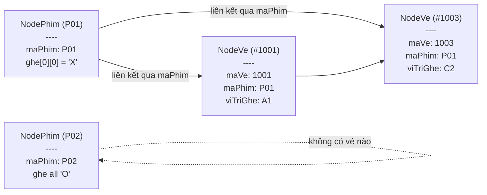

# 🎬 Hệ Thống Đặt Vé Xem Phim — Thiết Kế & Flow

> **Ngôn ngữ**: C++ | **Cấu trúc dữ liệu**: Linked List | **Database**: 1 file `.txt`

---

## 📐 Kiến Trúc Tổng Quan

````mermaid
flowchart TD
    A([🚀 Khởi động chương trình]) --> B[Đọc file\ncinema_db.txt]
    B --> C{File tồn tại?}
    C -- Không --> D[Tự tạo dữ liệu mẫu\nrồi ghi vào file]
    C -- Có --> E[Nạp dữ liệu vào\n2 Linked List trên RAM]
    D --> E
    E --> F[[🖥️ Vòng lặp Menu chính]]

    F --> G[1. Xem phim & Sơ đồ ghế]
    F --> H[2. Đặt vé]
    F --> I[3. Hủy vé]
    F --> J[4. Xem danh sách vé]
    F --> K[5. Thống kê doanh thu]
    F --> L[0. Thoát]

    H --> M[[🎯 Flow Đặt Vé]]
    I --> N[[🗑️ Flow Hủy Vé]]
    L --> O[Ghi file lần cuối\n+ Giải phóng bộ nhớ]
    O --> P([❌ Kết thúc])
````

---

## 🎯 Flow Đặt Vé Chi Tiết

````mermaid
flowchart TD
    Start([Người dùng chọn chức năng 2]) --> A[Hiển thị danh sách phim]
    A --> B[/"Nhập Mã phim (VD: P01)"/]
    B --> C{Tìm phim trong\nLinked List Phim?}
    C -- Không tìm thấy --> ERR1[❌ Báo lỗi\nQuay lại Menu]
    C -- Tìm thấy --> D[Hiển thị Sơ đồ ghế\nma trận 5x6: A1 - E6]
    D --> E[/"Nhập vị trí ghế (VD: A3)"/]
    E --> F{Kiểm tra ghế\nhợp lệ?}
    F -- Sai format hoặc ngoài biên --> ERR2[❌ Báo lỗi\nQuay lại Menu]
    F -- Hợp lệ --> G{Ghế đang\ntrống 'O'?}
    G -- Đã bị đặt 'X' --> ERR3[❌ Ghế đã có người\nQuay lại Menu]
    G -- Còn trống --> H[/"Nhập Tên khách + Số điện thoại"/]
    H --> I["Đổi ghe[hang][cot] = 'X'\ntrên node Phim trong RAM"]
    I --> J[Tạo struct Ve mới\nGán maVeTuTang++]
    J --> K[themVeVaoCuoi\nChèn node vé vào đuôi\nLinked List Vé]
    K --> L[ghiFileDatabase\nGhi đè toàn bộ\nvào cinema_db.txt]
    L --> End(["✅ Thành công\nIn mã vé #1001"])
````

---

## 🗑️ Flow Hủy Vé Chi Tiết

````mermaid
flowchart TD
    Start([Người dùng chọn chức năng 3]) --> A[/"Nhập Mã vé cần hủy (VD: 1001)"/]
    A --> B{Tìm vé trong\nLinked List Vé?}
    B -- Không tìm thấy --> ERR[❌ Báo lỗi\nQuay lại Menu]
    B -- Tìm thấy --> C[Đọc maPhim + viTriGhe\ntừ node vé]
    C --> D[timPhimTheoMa\nTìm node Phim trên RAM]
    D --> E["Đổi ghe[hang][cot] = 'O'\n(Giải phóng ghế)"]
    E --> F[xoaVeTheoMa\nXóa node vé\nkhỏi Linked List Vé]
    F --> G[ghiFileDatabase\nGhi đè lại file txt]
    G --> End(["✅ Hủy vé thành công\nGhế đã mở lại"])
````

---

## 🧱 Cấu Trúc Dữ Liệu (Struct)

```cpp
// --- PHIM ---
struct Phim {
    string maPhim;
    string tenPhim;
    string theLoai;
    int    thoiLuong;
    double giaVe;
    char   ghe[5][6]; // 'O' = trống | 'X' = đã đặt
};

struct NodePhim {
    Phim     data;
    NodePhim* next;
};

// --- VÉ ---
struct Ve {
    int    maVe;
    string tenKhach;
    string sdt;
    string maPhim;
    string viTriGhe;
    double giaTien;
};

struct NodeVe {
    Ve     data;
    NodeVe* next;
};
```

---

## ⚙️ Các Hàm Cần Thiết

### Nhóm 1 — Xử lý Ghế
| Tên hàm | Tham số | Trả về | Mô tả |
|---|---|---|---|
| `khoiTaoGhe` | `Phim&` | `void` | Gán tất cả ghế = `'O'` |
| `hienThiSoDoGhe` | `const Phim&` | `void` | In ma trận ghế ra terminal |
| `kiemTraGheHopLe` | `string, int&, int&` | `bool` | Phân tích "A1" → hàng 0, cột 0 |
| `chuyenGheThanhChuoi` | `const Phim&` | `string` | Nén `ghe[5][6]` → chuỗi 30 ký tự để ghi file |
| `napChuoiVaoGhe` | `Phim&, string` | `void` | Giải nén chuỗi 30 ký tự → `ghe[5][6]` khi đọc file |

### Nhóm 2 — Linked List
| Tên hàm | Tham số | Trả về | Mô tả |
|---|---|---|---|
| `themPhimVaoCuoi` | `NodePhim*&, Phim` | `void` | Tạo node mới, nối vào đuôi danh sách phim |
| `themVeVaoCuoi` | `NodeVe*&, Ve` | `void` | Tạo node mới, nối vào đuôi danh sách vé |
| `timPhimTheoMa` | `NodePhim*, string` | `NodePhim*` | Duyệt list, trả về con trỏ node phim |
| `timVeTheoMa` | `NodeVe*, int` | `NodeVe*` | Duyệt list, trả về con trỏ node vé |
| `xoaVeTheoMa` | `NodeVe*&, int` | `bool` | Xóa node vé, trả `true` nếu xóa được |
| `giaiPhongBoNho` | `NodePhim*&, NodeVe*&` | `void` | `delete` tất cả node khi thoát app |

### Nhóm 3 — File Database
| Tên hàm | Mô tả |
|---|---|
| `taoDuLieuMauNeuChuaCo` | Kiểm tra file, nếu chưa có thì tạo mới với 4 phim mặc định |
| `docFileDatabase` | Đọc file → nạp vào `headPhim` & `headVe` + tính `maVeTuTang` |
| `ghiFileDatabase` | Duyệt 2 Linked List → ghi đè toàn bộ vào file txt |

### Nhóm 4 — Nghiệp Vụ
| Tên hàm | Mô tả |
|---|---|
| `xemDanhSachPhim` | In bảng danh sách phim từ Linked List Phim |
| `xemSoDoGhe` | Gọi `xemDanhSachPhim` → nhập mã → gọi `hienThiSoDoGhe` |
| `datVe` | Toàn bộ flow đặt vé (xem sơ đồ flow ở trên) |
| `huyVe` | Toàn bộ flow hủy vé |
| `xemDanhSachVe` | In bảng tất cả vé từ Linked List Vé |
| `thongKeDoanhThu` | Duyệt 2 List, tính tổng vé + tiền theo từng phim |

---

## 📁 Skeleton `main.cpp`

```cpp
#include <iostream>
#include <fstream>
#include <sstream>
#include <string>
#include <iomanip>
using namespace std;

// --- HẰNG SỐ ---
const int SO_HANG_GHE = 5;
const int SO_COT_GHE  = 6;
const string TEN_FILE_DB = "cinema_db.txt";

// ==============================================
// 1. KHAI BÁO STRUCT & NODE LINKED LIST
// ==============================================
struct Phim { /* ... */ };
struct NodePhim { Phim data; NodePhim* next; };
struct Ve   { /* ... */ };
struct NodeVe   { Ve   data; NodeVe*   next; };

// ==============================================
// 2. HÀM XỬ LÝ GHẾ
// ==============================================
void   khoiTaoGhe(Phim& phim)                               { /* TODO */ }
void   hienThiSoDoGhe(const Phim& phim)                     { /* TODO */ }
bool   kiemTraGheHopLe(const string& viTri, int& h, int& c) { /* TODO */ }
string chuyenGheThanhChuoi(const Phim& phim)                { /* TODO */ }
void   napChuoiVaoGhe(Phim& phim, const string& s)          { /* TODO */ }

// ==============================================
// 3. HÀM LINKED LIST
// ==============================================
void      themPhimVaoCuoi(NodePhim*& head, Phim p) { /* TODO */ }
void      themVeVaoCuoi  (NodeVe*&   head, Ve   v) { /* TODO */ }
NodePhim* timPhimTheoMa  (NodePhim*  head, const string& ma) { /* TODO */ }
NodeVe*   timVeTheoMa    (NodeVe*    head, int maVe)         { /* TODO */ }
bool      xoaVeTheoMa    (NodeVe*&   head, int maVe)         { /* TODO */ }
void      giaiPhongBoNho (NodePhim*& hP, NodeVe*& hV)        { /* TODO */ }

// ==============================================
// 4. HÀM FILE DATABASE
// ==============================================
void taoDuLieuMauNeuChuaCo(const string& tenFile)                                          { /* TODO */ }
void docFileDatabase       (const string& tenFile, NodePhim*& hP, NodeVe*& hV, int& maTT) { /* TODO */ }
void ghiFileDatabase       (const string& tenFile, NodePhim*  hP, NodeVe*  hV)            { /* TODO */ }

// ==============================================
// 5. HÀM NGHIỆP VỤ
// ==============================================
void xemDanhSachPhim  (NodePhim* hP)                                   { /* TODO */ }
void xemSoDoGhe       (NodePhim* hP)                                   { /* TODO */ }
void datVe            (NodePhim* hP, NodeVe*& hV, int& maTT, const string& f) { /* TODO */ }
void huyVe            (NodePhim* hP, NodeVe*& hV,            const string& f) { /* TODO */ }
void xemDanhSachVe    (NodeVe*   hV)                                   { /* TODO */ }
void thongKeDoanhThu  (NodePhim* hP, NodeVe* hV)                       { /* TODO */ }

// ==============================================
// 6. MENU & MAIN
// ==============================================
void hienThiMenu() {
    cout << "\n===== QUAN LY DAT VE XEM PHIM =====\n";
    cout << "  1. Xem danh sach phim & So do ghe\n";
    cout << "  2. Dat ve xem phim\n";
    cout << "  3. Huy ve xem phim\n";
    cout << "  4. Xem danh sach ve da dat\n";
    cout << "  5. Thong ke doanh thu\n";
    cout << "  0. Thoat\n";
    cout << "===================================\n";
    cout << "Chon [0-5]: ";
}

int main() {
    NodePhim* headPhim = nullptr;
    NodeVe*   headVe   = nullptr;
    int maVeTuTang = 1001;

    docFileDatabase(TEN_FILE_DB, headPhim, headVe, maVeTuTang);

    string luaChon;
    while (true) {
        hienThiMenu();
        getline(cin, luaChon);

        if      (luaChon == "1") xemSoDoGhe(headPhim);
        else if (luaChon == "2") datVe(headPhim, headVe, maVeTuTang, TEN_FILE_DB);
        else if (luaChon == "3") huyVe(headPhim, headVe, TEN_FILE_DB);
        else if (luaChon == "4") xemDanhSachVe(headVe);
        else if (luaChon == "5") thongKeDoanhThu(headPhim, headVe);
        else if (luaChon == "0") {
            ghiFileDatabase(TEN_FILE_DB, headPhim, headVe);
            break;
        }
    }

    giaiPhongBoNho(headPhim, headVe);
    return 0;
}
```

---

## 💾 Cấu Trúc File `cinema_db.txt`

```text
#PHIM
<maPhim>|<tenPhim>|<theLoai>|<thoiLuong>|<giaVe>|<chuoiGhe30kytu>
#VE
<maVe>|<tenKhach>|<sdt>|<maPhim>|<viTriGhe>|<giaTien>
```

**Ví dụ thực tế:**
```text
#PHIM
P01|Avatar: The Way of Water|Hanh Dong|192|90000|XOOOOOOOOOOOOOOOOOOOOOOOOOOOO O
P02|Oppenheimer|Lich Su|180|85000|OOOOOOOOOOOOOOOOOOOOOOOOOOOOOO
P03|Doraemon|Hoat Hinh|115|75000|OOOOOOOOOOOOOOOOOOOOOOOOOOOOOO
#VE
1001|Nguyen Van A|0912345678|P01|A1|90000
1002|Tran Thi B|0987654321|P01|B3|90000
```

> [!NOTE]
> Chuỗi ghế có **30 ký tự** = `5 hàng × 6 cột`. Ví dụ ký tự đầu là `X` có nghĩa ghế `A1` đã bị đặt, các ký tự còn lại là `O` tức còn trống.

> [!TIP]
> Mỗi lần **đặt vé** hoặc **hủy vé** thành công, hàm `ghiFileDatabase` sẽ ghi đè **toàn bộ** file để đảm bảo dữ liệu không bị mất khi tắt chương trình đột ngột.

---

## 🔗 Mối Quan Hệ Dữ Liệu Giữa Phim và Vé


