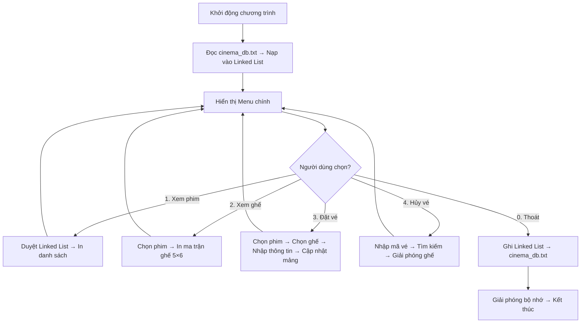
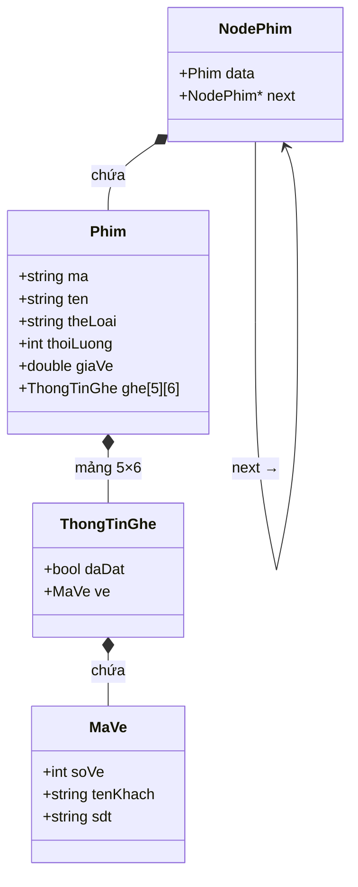

### 1. Khởi động (Startup)
```
  ./main
    │
    └──► main()
          │
          ├──► khoiTaoHeThong()
          │      ├──► kiemTraDBTrong("cinema_db.txt")
          │      │      ├── [File rỗng] ──► Dừng, báo DB trống
          │      │      └── [Có dữ liệu]
          │      │            └──► docDanhSachPhim()
          │      │                   ├── Đọc dòng '#' ──► themPhim() (tạo node trên RAM)
          │      │                   ├── Đọc 30 dòng ghế ──► gán vào ghe[r][c]
          │      │                   └── Cập nhật biến veKeTiep
          │      └──► Đếm số node và in: "[Init] Da load X phim..."
──────

### 2. Thoát & Thu hồi bộ nhớ (Exit)

  Thoát vòng lặp
    │
    ├──► ghiToanBoFile()  (lưu an toàn lần cuối xuống cinema_db.txt)
    ├──► giaiPhong()      (chạy vòng lặp delete từng NodePhim, tránh rò rỉ RAM)
    └──► return 0         (kết thúc tiến trình)
──────


### Ví dụ về flow nhapDanhSachPhim
nhapDanhSachPhim() // -> sau khi khoiTaoHeThong xong đảm bảo đã có dữ liệu trên ram để thao tác.
            ├── Lặp: nhapMotPhim() // hàm con 
            │          ├── nhapChuoi() ──► kiemTraTrungMa() // valid con
            │          ├── nhapSoNguyen(), nhapSoThuc() // hàm valid chung có thể tái sử dụng
            │          └── Tạo 30 ghế trống (daDat = false) // logic nghiệp vụ
            ├── themPhim() (nối node vào RAM) // hàm con có thể tái sử dụng
            └── [Dừng nhập] ──► ghiToanBoFile() (ghi đè lại cinema_db.txt) // lưu lại vào db sao khi làm xong
──────


## NGUYÊN TẮC CHUNG CHO 1 HÀM: 

xác định vị trí code -> KHAI BÁO NGUYÊN MẪU (PROTOTYPES): vd: void nhapDanhSachPhim(NodePhim*& head);
                        │
                        ▼
[Thao tác] ──► Mọi Thêm / Sửa / Xóa / Đặt vé CHỈ LÀM TRÊN RAM (Linked List) -> làm nghiệp vụ logic 
                        │
                        ▼
[Lưu lại]  ──► ghiToanBoFile() (Quét sạch RAM ghi đè lại toàn bộ xuống DB) -> nhớ lưu lại vào db, có hàm vét linklist để lưu ghiToanBoFile;

```


## 1. THÔNG TIN

  

### 1.1. Bối cảnh

  

Trong bối cảnh ngành công nghiệp giải trí ngày càng phát triển, nhu cầu quản lý và đặt vé xem phim tại các rạp chiếu phim trở nên cấp thiết. Một hệ thống đặt vé hiệu quả không chỉ giúp rạp phim quản lý lịch chiếu, sơ đồ ghế ngồi mà còn mang lại sự tiện lợi cho khách hàng khi đặt vé.

  

### 1.2. Mục tiêu đề tài

  

Xây dựng **Hệ thống Quản lý Đặt vé Xem phim** (Movie Booking System) bằng ngôn ngữ **C++**, sử dụng các cấu trúc dữ liệu cơ bản nhằm:

  

- **Quản lý danh sách phim** đang chiếu tại rạp (mã phim, tên phim, thể loại, thời lượng, giá vé).

- **Quản lý sơ đồ ghế ngồi** cho từng phim (30 ghế, bố trí 5 hàng × 6 cột).

- **Đặt vé / hủy vé** cho khách hàng, ghi nhận thông tin (tên, số điện thoại, mã vé tự động).

- **Lưu trữ dữ liệu** xuống file cơ sở dữ liệu (`cinema_db.txt`) để dữ liệu được bảo toàn giữa các lần chạy.

  

### 1.3. Công nghệ sử dụng

  

| Thành phần | Công nghệ / Công cụ |

| :--- | :--- |

| Ngôn ngữ lập trình | C++ (chuẩn C++11 trở lên) |

| Cấu trúc dữ liệu chính | **Danh sách liên kết đơn** (Singly Linked List), Mảng 2 chiều (Matrix) |

| Lưu trữ dữ liệu | File text (`cinema_db.txt`) — định dạng tùy chỉnh |

| Trình biên dịch | g++ (MinGW / GCC) |

| Quản lý mã nguồn | Git & GitHub |

  

### 1.4. Phạm vi đề tài

  

- Chương trình chạy trên **giao diện dòng lệnh** (Console / Terminal).

- Dữ liệu được lưu trữ dưới dạng file text thay vì sử dụng hệ quản trị cơ sở dữ liệu.

- Phục vụ cho mục đích học tập, thực hành cấu trúc dữ liệu (Linked List, mảng 2D, struct, con trỏ).

  

---

  

## 2. Phân tích yêu cầu và mô tả giải pháp

  

### 2.1. Yêu cầu chức năng

  

| STT | Chức năng | Mô tả |

| :---: | :--- | :--- |

| 1 | **Xem danh sách phim** | Hiển thị tất cả các phim đang chiếu kèm thông tin: mã phim, tên, thể loại, thời lượng, giá vé. |

| 2 | **Xem sơ đồ ghế** | Hiển thị sơ đồ 5×6 = 30 ghế của một phim cụ thể, phân biệt ghế trống và ghế đã đặt. |

| 3 | **Đặt vé** | Khách chọn phim → chọn ghế trống → nhập tên và SĐT → hệ thống tạo mã vé tự động, đánh dấu ghế đã đặt. |

| 4 | **Hủy vé** | Nhập mã vé → hệ thống tìm kiếm và giải phóng ghế tương ứng, xóa thông tin khách. |

| 5 | **Lưu / đọc dữ liệu** | Khi khởi động: đọc toàn bộ dữ liệu từ `cinema_db.txt` vào RAM. Khi thoát: ghi toàn bộ dữ liệu ngược lại file. |

  

### 2.2. Yêu cầu phi chức năng

  

- **Tính nhất quán**: Dữ liệu trên RAM và trên file phải đồng bộ khi thoát chương trình.

- **Dễ bảo trì**: Mã nguồn chia thành các hàm / module rõ ràng, có chú thích đầy đủ.

- **Hiệu năng**: Sử dụng Linked List cho phép thêm/xóa phim linh hoạt mà không cần cấp phát mảng cố định.

  

### 2.3. Giải pháp tổng quan

  



  

---

  

## 3. Thiết kế cấu trúc dữ liệu và mô hình chương trình

  

### 3.1. Sơ đồ cấu trúc dữ liệu (Struct Hierarchy)

  

Chương trình sử dụng 4 struct lồng nhau và 1 danh sách liên kết đơn:

  



  

### 3.2. Chi tiết từng cấu trúc dữ liệu

  

#### 3.2.1. `MaVe` — Thông tin vé

  

| Trường | Kiểu | Ý nghĩa |

| :--- | :--- | :--- |

| `soVe` | `int` | Mã số vé (bắt đầu từ 1001, tự tăng). Giá trị `0` = chưa đặt. |

| `tenKhach` | `string` | Họ tên khách hàng |

| `sdt` | `string` | Số điện thoại khách hàng |

  

#### 3.2.2. `ThongTinGhe` — Trạng thái một ô ghế

  

| Trường | Kiểu | Ý nghĩa |

| :--- | :--- | :--- |

| `daDat` | `bool` | `false` = ghế trống, `true` = đã có người đặt |

| `ve` | `MaVe` | Thông tin vé (chỉ có nghĩa khi `daDat == true`) |

  

#### 3.2.3. `Phim` — Thông tin một bộ phim

  

| Trường | Kiểu | Ý nghĩa |

| :--- | :--- | :--- |

| `ma` | `string` | Mã phim (VD: `"P01"`) |

| `ten` | `string` | Tên phim (VD: `"Avatar: The Way of Water"`) |

| `theLoai` | `string` | Thể loại (VD: `"Hanh Dong"`) |

| `thoiLuong` | `int` | Thời lượng (phút) |

| `giaVe` | `double` | Giá vé mỗi ghế (VND) |

| `ghe[5][6]` | `ThongTinGhe[][]` | Ma trận sơ đồ 30 ghế (5 hàng A→E × 6 cột 1→6) |

  

#### 3.2.4. `NodePhim` — Node của Linked List

  

| Trường | Kiểu | Ý nghĩa |

| :--- | :--- | :--- |

| `data` | `Phim` | Dữ liệu phim chứa bên trong node |

| `next` | `NodePhim*` | Con trỏ trỏ đến node phim tiếp theo |

  

### 3.3. Mô hình Linked List trong bộ nhớ

  

```

headPhim ──→ [Phim P01] ──→ [Phim P02] ──→ [Phim P03] ──→ [Phim P04] ──→ nullptr

              │                │                │                │

              ▼                ▼                ▼                ▼

           ghe[5][6]       ghe[5][6]       ghe[5][6]       ghe[5][6]

           (30 ghế)        (30 ghế)        (30 ghế)        (30 ghế)

```

  

### 3.4. Sơ đồ ghế (Ma trận 5×6)

  

```

         Cột 1    Cột 2    Cột 3    Cột 4    Cột 5    Cột 6

Hàng A  ghe[0][0] ghe[0][1] ghe[0][2] ghe[0][3] ghe[0][4] ghe[0][5]   → Ghế 01–06

Hàng B  ghe[1][0] ghe[1][1] ghe[1][2] ghe[1][3] ghe[1][4] ghe[1][5]   → Ghế 07–12

Hàng C  ghe[2][0] ghe[2][1] ghe[2][2] ghe[2][3] ghe[2][4] ghe[2][5]   → Ghế 13–18

Hàng D  ghe[3][0] ghe[3][1] ghe[3][2] ghe[3][3] ghe[3][4] ghe[3][5]   → Ghế 19–24

Hàng E  ghe[4][0] ghe[4][1] ghe[4][2] ghe[4][3] ghe[4][4] ghe[4][5]   → Ghế 25–30

```

  

**Công thức chuyển đổi** giữa số ghế `i` (1–30) và tọa độ mảng:

```

r = (i - 1) / 6       (hàng, 0-indexed)

c = (i - 1) % 6       (cột,  0-indexed)

```

  

### 3.5. Định dạng File Database (`cinema_db.txt`)

  

```

#<MaPhim>|<TenPhim>|<TheLoai>|<ThoiLuong>|<GiaVe>      ← Header phim

01|O                                                      ← Ghế 01, trống

02|O                                                      ← Ghế 02, trống

03|X|1001|Nguyen Van A|0912345678                         ← Ghế 03, đã đặt

...

30|O                                                      ← Ghế 30, trống

#<MaPhim>|...                                             ← Phim tiếp theo

```

  