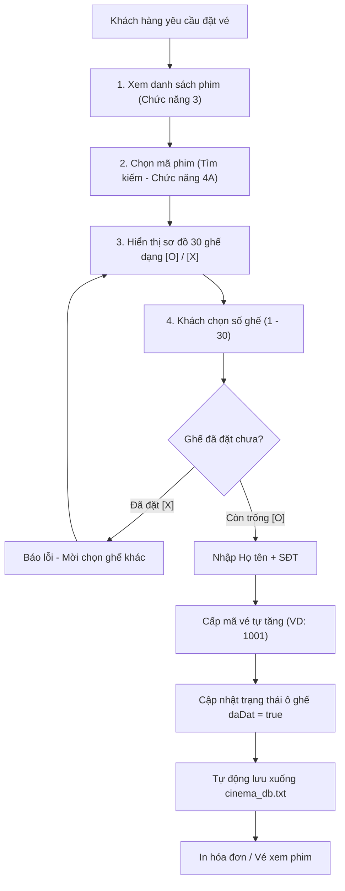

# TÀI LIỆU ĐẶC TẢ THIẾT KẾ NGHIỆP VỤ & HƯỚNG DẪN TRIỂN KHAI CRUD
## Hệ Thống Quản Lý Đặt Vé Xem Phim (Movie Booking System)

---

## MỤC LỤC
1. [Tổng Quan Kiến Trúc & Triết Lý Thiết Kế](#1-tổng-quan-kiến-trúc--triết-lý-thiết-kế)
2. [Cấu Trúc Dữ Liệu & Quy Ước Hệ Thống](#2-cấu-trúc-dữ-liệu--quy-ước-hệ-thống)
3. [Tầng Kiểm Tra Dữ Liệu Hợp Lệ (Validation Layer)](#3-tầng-kiểm-tra-dữ-liệu-hợp-lệ-validation-layer)
4. [Đặc Tả Chi Tiết 8 Nhóm Chức Năng CRUD](#4-đặc-tả-chi-tiết-8-nhóm-chức-năng-crud)
   - [4.1. Nhập danh sách đối tượng](#41-nhập-danh-sách-đối-tượng) 
   - [4.2. Thêm phần tử mới](#42-thêm-phần-tử-mới)
   - [4.3. Hiển thị danh sách](#43-hiển-thị-danh-sách)
   - [4.4. Tìm kiếm phần tử đa tiêu chí](#44-tìm-kiếm-phần-tử-đa-tiêu-chí)
   - [4.5. Xóa phần tử](#45-xóa-phần-tử)
   - [4.6. Cập nhật thông tin](#46-cập-nhật-thông-tin)
   - [4.7. Sắp xếp danh sách (Extensible Sorting)](#47-sắp-xếp-danh-sách-extensible-sorting)
   - [4.8. Đọc / Ghi file Text (Persistence Layer)](#48-đọc--ghi-file-text-persistence-layer)
5. [Quy Trình Tích Hợp Vào Nghiệp Vụ Phòng Vé](#5-quy-trình-tích-hợp-vào-nghiệp-vụ-phòng-vé)
6. [Kế Hoạch & Các Bước Thực Hiện Dự Kiến](#6-kế-hoạch--các-bước-thực-hiện-dự-kiến)

---

## 1. TỔNG QUAN KIẾN TRÚC & TRIẾT LÝ THIẾT KẾ

Để đảm bảo hệ thống dễ dàng bảo trì, hạn chế tối đa lỗi bộ nhớ và sẵn sàng mở rộng thêm tính năng mới, mã nguồn được phân tách theo mô hình 3 tầng logic:

```
┌────────────────────────────────────────────────────────┐
│               TẦNG GIAO DIỆN (UI LAYER)                │
│       Menu chính, Sub-menu, Căn chỉnh bảng console     │
└───────────────────────────┬────────────────────────────┘
                            │
┌───────────────────────────▼────────────────────────────┐
│             TẦNG NGHIỆP VỤ (BUSINESS LOGIC)            │
│  Validation, CRUD Phim, Thuật toán Sắp xếp, Tìm kiếm,  │
│         Xử lý logic Đặt vé / Hủy vé / Giữ chỗ          │
└───────────────────────────┬────────────────────────────┘
                            │
┌───────────────────────────▼────────────────────────────┐
│             TẦNG DỮ LIỆU (DATA / PERSISTENCE)          │
│  Danh sách liên kết đơn (Linked List), File cinema_db  │
└────────────────────────────────────────────────────────┘
```

### Các nguyên tắc cốt lõi:
1. **Single Responsibility Principle (Đơn nhiệm):** Mỗi hàm chỉ làm đúng một việc duy nhất (hàm nhập dữ liệu không thực hiện vẽ bảng; hàm tìm kiếm không tự ý xóa node).
2. **DRY (Don't Repeat Yourself - Tái sử dụng tối đa):** 
   - Hàm `timNodeTheoMa()` là hạt nhân dùng chung cho: Tìm kiếm, Cập nhật, Xóa, Xem sơ đồ ghế và Đặt vé.
   - Hàm nhập an toàn (`nhapSoNguyen`, `nhapChuoi`) dùng cho toàn bộ hệ thống để triệt tiêu lỗi trôi lệnh `cin` và crash do sai kiểu dữ liệu.
3. **Open / Closed Principle (Đóng để sửa, Mở để nâng cấp):**
   - Áp dụng kỹ thuật **Con trỏ hàm (Function Pointer)** cho module Sắp xếp. Khi cần thêm tiêu chí sắp xếp mới (ví dụ: theo thời lượng, theo số lượng ghế trống), chỉ cần viết thêm 1 hàm so sánh nhỏ mà không cần sửa thuật toán sắp xếp chính.
4. **Data Integrity (Toàn vẹn dữ liệu):**
   - Khóa chính (`ma`) là bất biến (không cho phép sửa sau khi tạo).
   - Tự động đồng bộ hóa xuống file database sau mỗi giao dịch thay đổi dữ liệu để phòng ngừa mất dữ liệu khi mất điện/tắt đột ngột.

---

## 2. CẤU TRÚC DỮ LIỆU & QUY ƯỚC HỆ THỐNG

### 2.1. Cấu trúc lồng nhau (Nested Structures)

```
NodePhim (Linked List)
  └── Phim (data)
        ├── ma (string - Khóa chính)
        ├── ten (string)
        ├── theLoai (string)
        ├── thoiLuong (int - phút)
        ├── giaVe (double - VND)
        └── ghe[5][6] (Ma trận 30 ghế)
              └── ThongTinGhe
                    ├── daDat (bool)
                    └── ve (MaVe)
                          ├── soVe (int)
                          ├── tenKhach (string)
                          └── sdt (string)
```

### 2.2. Hằng số hệ thống
```cpp
const int SO_HANG = 5;                  // Hàng A -> E
const int SO_COT  = 6;                  // Cột 1 -> 6
const int TONG_GHE = SO_HANG * SO_COT;  // 30 ghế
const string FILE_DB = "cinema_db.txt";
```

### 2.3. Quy ước tọa độ ghế
- Ghế được đánh số liên tục từ `01` đến `30`.
- Ánh xạ giữa chỉ số ghế `so` ($1 \le so \le 30$) và chỉ số ma trận `ghe[r][c]`:
  $$\text{r (hàng)} = \frac{so - 1}{\text{SO\_COT}} \quad (0 \le r \le 4 \leftrightarrow A \dots E)$$
  $$\text{c (cột)} = (so - 1) \pmod{\text{SO\_COT}} \quad (0 \le c \le 5 \leftrightarrow 1 \dots 6)$$

---

## 3. TẦNG KIỂM TRA DỮ LIỆU HỢP LỆ (VALIDATION LAYER)

Mọi chức năng thêm/sửa đều phải đi qua tầng này trước khi dữ liệu được ghi vào bộ nhớ RAM.

### 3.1. Các hàm trợ giúp nhập liệu an toàn
* `string nhapChuoi(string thongBao)`:
  - Bắt buộc người dùng không được bỏ trống chuỗi.
  - Tự động dọn dẹp ký tự khoảng trắng thừa ở đầu/cuối.
* `int nhapSoNguyen(string thongBao, int minVal, int maxVal)`:
  - Chống crash khi người dùng cố tình nhập chữ vào ô số.
  - Sử dụng `getline` kết hợp `stringstream` hoặc `try...catch stoi`. Bắt buộc $minVal \le value \le maxVal$.
* `double nhapSoThuc(string thongBao, double minVal, double maxVal)`:
  - Kiểm tra tương tự số nguyên, áp dụng cho trường `giaVe`.
* `bool xacNhan(string thongBao)`:
  - Yêu cầu nhập `y` hoặc `n` khi thực hiện các hành động nguy hiểm (như Xóa phim, Hủy vé).

### 3.2. Ràng buộc dữ liệu nghiệp vụ
| Thuộc tính | Kiểu dữ liệu | Tiêu chuẩn hợp lệ | Xử lý khi vi phạm |
| :--- | :--- | :--- | :--- |
| `ma` | `string` | Không rỗng, không chứa ký tự `\|`, **duy nhất trong toàn bộ list** | Thông báo trùng, yêu cầu nhập lại |
| `ten` | `string` | Độ dài từ 2 đến 100 ký tự, không chứa `\|` | Bắt nhập lại |
| `theLoai` | `string` | Không chứa `\|` (Hành Động, Tâm Lý, Hoạt Hình, v.v.) | Bắt nhập lại |
| `thoiLuong` | `int` | $15 \le \text{thoiLuong} \le 360$ (phút) | Cảnh báo ngoài ngưỡng phim hợp lý |
| `giaVe` | `double` | $10,000 \le \text{giaVe} \le 1,000,000$ (VND) | Cảnh báo sai quy chuẩn giá vé rạp |

*(Lưu ý: Không được chứa ký tự `|` vì ký tự này dùng làm delimiter phân tách trường trong file database)*.

---

## 4. ĐẶC TẢ CHI TIẾT 8 NHÓM CHỨC NĂNG CRUD

---

### 4.1. Nhập danh sách đối tượng
* **Mô tả nghiệp vụ:** Cho phép người dùng nhập nhanh một lô nhiều bộ phim từ bàn phím thay vì nhập từng phim lẻ tẻ. Thường sử dụng khi rạp muốn lên lịch chiếu ban đầu cho ngày mới.
* **Quy trình thực hiện:**
  1. Nhập số lượng phim cần nạp $N$ (hoặc cho nhập liên tục đến khi người dùng chọn dừng).
  2. Với mỗi phim thứ $i$:
     - Nhập thông tin chi tiết qua hàm chuẩn hóa `nhapMotPhim()`.
     - Kiểm tra trùng mã: Nếu mã đã tồn tại trong danh sách thì từ chối và yêu cầu nhập lại mã khác.
     - Khởi tạo toàn bộ ma trận 30 ghế của phim về trạng thái **trống** (`daDat = false`).
     - Chèn vào cuối danh sách liên kết.
  3. Sau khi kết thúc vòng lặp, thông báo tổng số lượng phim đã nạp thành công.
* **Hướng mở rộng:** Cho phép đọc nhập danh sách nhanh từ một file CSV/Text bên ngoài vào danh sách hiện tại mà không làm mất các phim cũ.

---

### 4.2. Thêm phần tử mới
* **Mô tả nghiệp vụ:** Bổ sung 1 phim mới vào rạp chiếu trong quá trình hệ thống đang vận hành.
* **Thuật toán xử lý:**
  ```text
  BƯỚC 1: Gọi hàm nhapChuoi() để lấy mã phim mới.
  BƯỚC 2: Gọi kiemTraTrungMa(head, maMoi).
          -> NẾU tìm thấy: Xuất thông báo lỗi "Mã đã tồn tại", kết thúc hàm hoặc yêu cầu nhập lại.
  BƯỚC 3: Nhập các thông tin còn lại: Tên, Thể loại, Thời lượng, Giá vé (đã validate).
  BƯỚC 4: Khởi tạo 30 ô ghế trống: ghe[r][c].daDat = false.
  BƯỚC 5: Gọi hàm themPhim(head, phimMoi) để tạo node mới và nối vào đuôi linked list.
  BƯỚC 6: Gọi ghiToanBoFile() để lưu ngay dữ liệu mới vào cinema_db.txt.
  ```
* **Độ phức tạp:** $O(n)$ do duyệt tìm trùng mã và chèn cuối danh sách liên kết.
* **Hướng mở rộng:** Duy trì thêm con trỏ `tailPhim` bên cạnh `headPhim` để hạ độ phức tạp chèn cuối xuống $O(1)$.

---

### 4.3. Hiển thị danh sách
* **Mô tả nghiệp vụ:** Xuất bảng danh sách tất cả các phim đang được chiếu tại rạp dưới dạng bảng có kẻ khung ngay ngắn, dễ theo dõi.
* **Thiết kế giao diện bảng:**
  ```text
  ========================================================================================
  | Mã Phim | Tên Phim                     | Thể Loại   | Thời Lượng | Giá Vé (VND)      |
  ========================================================================================
  | P01     | Avatar: The Way of Water     | Hanh Dong  | 192 phut   | 90,000 VND        |
  | P02     | Oppenheimer                  | Lich Su    | 180 phut   | 85,000 VND        |
  ========================================================================================
  Tổng số phim đang chiếu: 2
  ```
* **Quy chuẩn kỹ thuật:**
  - Dùng `printf` hoặc `std::setw` + `std::left` để cố định độ rộng từng cột, tránh việc tên phim dài làm vỡ bảng.
  - Số ghế trống còn lại của mỗi phim có thể được thống kê thêm ở cột cuối để nhân viên tiện tư vấn khách.

---

### 4.4. Tìm kiếm phần tử đa tiêu chí
Hệ thống cung cấp một Sub-menu chuyên biệt phục vụ 4 nghiệp vụ tìm kiếm:

#### A. Tìm kiếm chính xác theo Mã (Core Function)
* **Mục đích:** Là hàm nền tảng, trả về **con trỏ `NodePhim*`** trực tiếp đến node trong danh sách để các module khác (Update, Delete, Booking) làm việc.
* **Hàm mẫu:** `NodePhim* timPhimTheoMa(NodePhim* head, string maTim);`

#### B. Tìm kiếm tương đối theo Tên
* **Mục đích:** Khách hàng hoặc nhân viên chỉ nhớ một từ khóa trong tên phim (Ví dụ: "Avatar", "Oppen", "mat").
* **Thuật toán:**
  - Chuẩn hóa chuỗi tìm kiếm và tên phim: chuyển thành chữ thường (lowercase).
  - Sử dụng hàm `string::find(tuKhoa) != string::npos`.
  - Hiển thị danh sách tất cả các phim thỏa mãn điều kiện.

#### C. Tìm kiếm theo Thể loại (Ánh xạ từ Lớp / Phòng ban)
* **Mục đích:** Liệt kê toàn bộ các phim thuộc một thể loại cụ thể (Hành Động, Hoạt Hình, Kinh Dị,...).
* **Thuật toán:** Tương tự tìm kiếm theo tên, so sánh chuỗi trên trường `theLoai`.

#### D. Tìm kiếm theo khoảng Giá vé
* **Mục đích:** Lọc các phim phù hợp với túi tiền của khách hàng ($GiaMin \le giaVe \le GiaMax$).
* **Thuật toán:**
  - Nhập $GiaMin$ và $GiaMax$ từ bàn phím.
  - Duyệt danh sách, in ra các phim có `giaVe` nằm trong đoạn $[GiaMin, GiaMax]$.

---

### 4.5. Xóa phần tử
* **Mô tả nghiệp vụ:** Gỡ bỏ một bộ phim đã ngừng chiếu ra khỏi hệ thống rạp.
* **Các ca biên (Edge cases) phải xử lý trong Linked List:**
  1. **Danh sách rỗng:** Báo lỗi và dừng.
  2. **Xóa phần tử đầu danh sách (`head`):** `head = head->next; delete nodeCu;`
  3. **Xóa phần tử ở giữa hoặc cuối:** Duyệt giữ con trỏ `prev` và `curr`. Khi tìm thấy: `prev->next = curr->next; delete curr;`
  4. **Không tìm thấy mã cần xóa:** Báo thông báo cho người dùng.
* **Ràng buộc nghiệp vụ an toàn:**
  - Trước khi `delete`, phải hỏi xác nhận: *"Bạn có chắc chắn muốn xóa phim [Tên Phim]? (y/n)"*.
  - Kiểm tra xem phim có ghế nào đang được đặt hay không. Nếu có, cần hiển thị cảnh báo: *"Phim này đang có vé đã đặt, bạn có chắc chắn muốn hủy toàn bộ và xóa?"*.
  - Sau khi xóa thành công, tự động gọi `ghiToanBoFile()` để cập nhật file txt.

---

### 4.6. Cập nhật thông tin
* **Mô tả nghiệp vụ:** Điều chỉnh thông tin của một bộ phim (ví dụ: đổi giá vé giờ vàng, chỉnh sửa tên phim hoặc thời lượng).
* **Quy tắc an toàn:**
  - **TUYỆT ĐỐI KHÔNG SỬA MÃ PHIM:** Mã phim là khóa chính định danh và liên kết sơ đồ ghế.
* **Menu cập nhật thuộc tính:**
  ```text
  --- CẬP NHẬT THÔNG TIN PHIM [P01 - Avatar] ---
  1. Đổi tên phim
  2. Đổi thể loại
  3. Đổi thời lượng
  4. Cập nhật lại giá vé
  5. Cập nhật toàn bộ thông tin
  0. Quay lại
  ```
* **Quy trình:**
  1. Tìm phim bằng `timPhimTheoMa()`. Nếu không thấy -> báo lỗi.
  2. Hiển thị giá trị cũ của thuộc tính được chọn.
  3. Nhập giá trị mới -> chạy qua hàm validate tương ứng -> gán giá trị mới.
  4. Ghi dữ liệu xuống file `cinema_db.txt`.

---

### 4.7. Sắp xếp danh sách (Extensible Sorting)
* **Triết lý kỹ thuật:** Thay vì tráo đổi các con trỏ `next` phức tạp và dễ gây đứt gãy danh sách, hệ thống sử dụng cơ chế **hoán đổi dữ liệu (Swap Data)** giữa 2 node kề nhau.
* **Thuật toán:** Bubble Sort hoặc Selection Sort trên Linked List.
* **Thiết kế mở rộng bằng Con trỏ hàm (Function Pointer):**
  ```cpp
  // Hàm tổng quát: Nhận vào hàm so sánh tiêu chí
  void sapXepPhim(NodePhim* head, bool (*hamSoSanh)(const Phim&, const Phim&)) {
      if (!head || !head->next) return;
      bool daHoanDoi;
      do {
          daHoanDoi = false;
          NodePhim* p = head;
          while (p->next != nullptr) {
              if (hamSoSanh(p->data, p->next->data)) {
                  std::swap(p->data, p->next->data);
                  daHoanDoi = true;
              }
              p = p->next;
          }
      } while (daHoanDoi);
  }
  ```
* **Các hàm tiêu chuẩn hỗ trợ:**
  1. `ssMaTang`: `a.ma > b.ma` (Sắp mã tăng dần)
  2. `ssMaGiam`: `a.ma < b.ma` (Sắp mã giảm dần)
  3. `ssTenAZ`: `a.ten > b.ten` (Sắp tên phim từ A đến Z)
  4. `ssTenZA`: `a.ten < b.ten` (Sắp tên phim từ Z về A)
  5. `ssGiaTang`: `a.giaVe > b.giaVe` (Sắp giá vé tăng dần)
  6. `ssGiaGiam`: `a.giaVe < b.giaVe` (Sắp giá vé giảm dần)
* **Khả năng mở rộng:** Khi muốn bổ sung tiêu chí *"Sắp xếp theo thời lượng"*, lập trình viên chỉ cần viết thêm hàm `ssThoiLuong` và truyền vào `sapXepPhim`, không cần chạm vào thuật toán sắp xếp.

---

### 4.8. Đọc / Ghi file Text (Persistence Layer)
* **Định dạng file `cinema_db.txt`:**
  - Header mỗi phim bắt đầu bằng `#`: `#<ma>|<ten>|<theLoai>|<thoiLuong>|<giaVe>`
  - Ngay sau header là 30 dòng đại diện cho 30 ghế:
    + Ghế trống: `<so>|O`
    + Ghế đã đặt: `<so>|X|<soVe>|<tenKhach>|<sdt>`
* **Quy trình Đọc file (`docDanhSachPhim`):**
  - Đọc từng dòng bằng `getline`.
  - Phân tích cú pháp: Nếu gặp `#` -> tạo struct `Phim`, parse các trường qua `stringstream`.
  - Nếu gặp số thứ tự ghế -> parse trạng thái và thông tin vé, điền trực tiếp vào `ghe[r][c]`.
  - Tự động duy trì biến toàn cục `veKeTiep = max(soVe) + 1` để khi sinh mã vé mới không bị trùng.
* **Quy trình Ghi file (`ghiToanBoFile`):**
  - Mở file ở chế độ ghi đè (`ofstream f(file)`).
  - Duyệt tuần tự linked list: Với mỗi phim ghi 1 dòng Header và duyệt 2 vòng lặp lồng nhau (5 hàng x 6 cột) để ghi ra đúng 30 dòng trạng thái ghế.
  - Đóng file an toàn.

---

## 5. QUY TRÌNH TÍCH HỢP VÀO NGHIỆP VỤ PHÒNG VÉ

Sau khi tầng CRUD cơ bản hoàn thành, các tính năng nghiệp vụ đặc thù của rạp chiếu phim được liên kết chặt chẽ như sau:



---

## 6. KẾ HOẠCH & CÁC BƯỚC THỰC HIỆN DỰ KIẾN

Việc lập trình dự kiến được tiến hành tuần tự theo 5 bước để đảm bảo tính ổn định:

| Giai đoạn | Nội dung công việc cụ thể | File tác động | Tiêu chí hoàn thành (DoD) |
| :--- | :--- | :--- | :--- |
| **Bước 1: Nền tảng Validation** | Xây dựng bộ hàm `nhapChuoi`, `nhapSoNguyen`, `nhapSoThuc`, `xacNhan`. | `main.cpp` | Không bị trôi dòng, nhập ký tự chữ vào ô số không bị crash chương trình. |
| **Bước 2: Tìm kiếm & Thêm mới** | Viết `timPhimTheoMa`, `kiemTraTrungMa`, `themPhimMoi`. | `main.cpp` | Thêm phim thành công, chặn hoàn toàn việc nhập trùng mã phim. |
| **Bước 3: Xóa & Cập nhật** | Hoàn thành `xoaPhim`, `capNhatPhim`. | `main.cpp` | Xóa đúng node (đầu, giữa, cuối), giải phóng bộ nhớ sạch sẽ; sửa được từng trường thuộc tính. |
| **Bước 4: Sắp xếp & Lọc nâng cao**| Triển khai hàm generic `sapXepPhim` bằng function pointer; tìm kiếm theo tên, thể loại, giá. | `main.cpp` | Đổi qua lại các tiêu chí sắp xếp mượt mà, tìm kiếm trả về đúng danh sách con. |
| **Bước 5: Nghiệp vụ Đặt vé & Menu** | Viết `xemSoDoGhe`, `datVe`, `huyVe`; hoàn thiện Menu chính và các Sub-menu lồng nhau. | `main.cpp` | Quy trình đặt vé lưu trực tiếp vào file txt và xem lại được sơ đồ ghế chính xác. |

---
*Tài liệu này là đặc tả kỹ thuật chính thức của dự án. Mọi thành viên phát triển cần tuân thủ cấu trúc hàm và quy ước đặt tên để đảm bảo tính đồng bộ của mã nguồn.*
