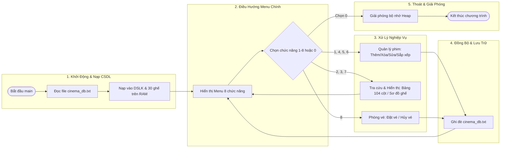
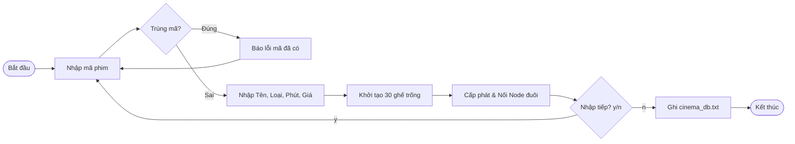
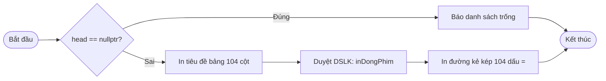
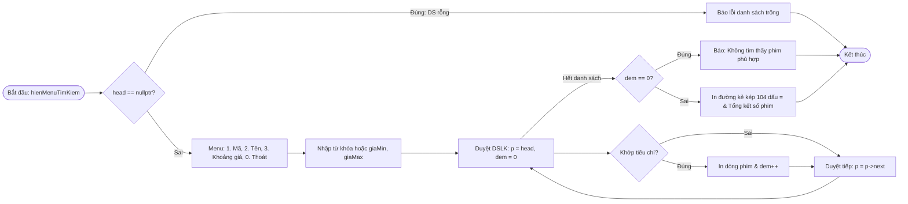
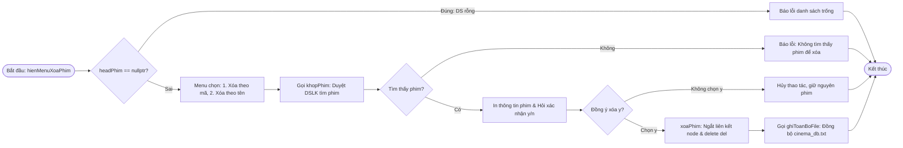
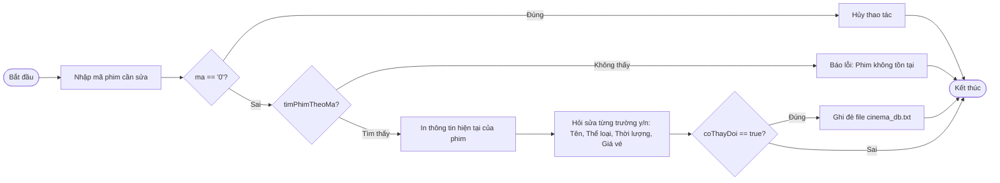
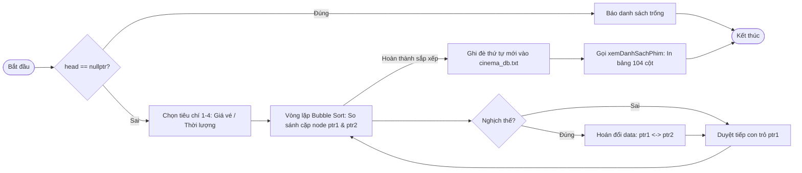
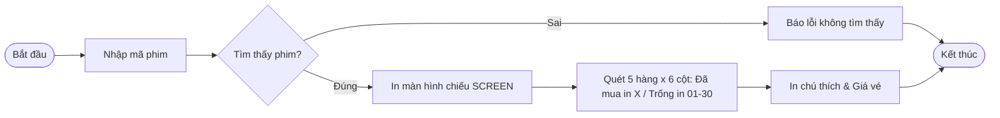
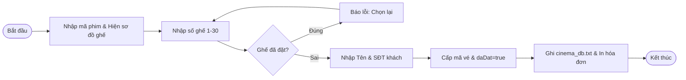
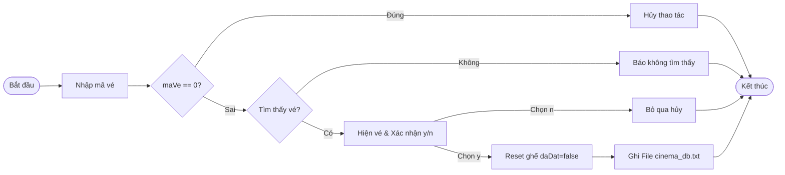

# BÁO CÁO TIỂU LUẬN: HỆ THỐNG QUẢN LÝ ĐẶT VÉ RẠP CHIẾU PHIM
Ứng dụng Cấu trúc Dữ liệu Danh sách Liên kết Đơn & Mảng 2 Chiều trong C++
* **Môn học:** Cấu trúc Dữ liệu & Giải thuật
* **Nhóm sinh viên thực hiện:** Nhóm 3 thành viên
* **Giảng viên hướng dẫn:** [Điền tên Thầy / Cô]
* **Nền tảng phát triển:** C++ (Standard 17) | Quản lý Cơ sở dữ liệu File văn bản (cinema_db.txt)

---

# 1. Phân tích Yêu cầu Bài toán & Giải pháp Kỹ thuật
Khảo sát thực tế nghiệp vụ rạp chiếu phim và đề xuất mô hình giải pháp phần mềm

### 📋 Phân tích Yêu cầu Nghiệp vụ
* **Yêu cầu quản lý phim:** Cần một hệ thống linh hoạt để thêm mới phim, tra cứu theo nhiều tiêu chí (mã, tên, giá vé), hiển thị danh mục rõ ràng, chỉnh sửa thông tin và sắp xếp danh sách.
* **Yêu cầu quản lý phòng chiếu:** Mỗi bộ phim có một phòng chiếu riêng gồm 30 ghế ngồi (5 hàng x 6 cột). Giao diện cần trực quan để nhận diện ghế nào còn trống có thể bán và ghế nào đã có khách đặt.
* **Yêu cầu nghiệp vụ phòng vé:** Hỗ trợ đặt vé nhanh chóng, tự động phát hiện và chặn việc chọn trùng ghế đã bán, tự sinh mã vé duy nhất không trùng lặp, hỗ trợ hủy vé an toàn và hoàn trả ghế trống tức thì.
* **Yêu cầu phi chức năng:** Dữ liệu phải được lưu trữ bền vững (Persistence) xuống file, không bị mất khi tắt máy; phần mềm phải chạy ổn định, chống trôi lệnh và không bị văng (crash) khi người dùng nhập sai kiểu dữ liệu.

### 💡 Đề xuất Giải pháp Kỹ thuật
* **Danh sách liên kết đơn (Singly Linked List):** Dùng để quản lý danh mục phim trên bộ nhớ RAM. Ưu điểm: Cấp phát động linh hoạt, dễ dàng thêm mới hoặc xóa bỏ phim trong quá trình chạy mà không bị giới hạn kích thước như mảng tĩnh.
* **Mảng 2 chiều 5x6 lồng Struct:** Mỗi phim sở hữu một ma trận `ghe[5][6]` độc lập, lưu trữ trực tiếp trạng thái ghế và thông tin vé của khách hàng.
* **Bộ hàm Input Validation:** Dùng `getline()` và `stringstream` để bắt lỗi nhập liệu ngay từ đầu, loại bỏ hoàn toàn lỗi trôi lệnh của `cin`.

---

# 2. Thiết kế Cấu trúc Dữ liệu & Mô hình Chương trình
Tổ chức các Struct dữ liệu, kiến trúc tổng quan hệ thống và mô hình liên kết động trên RAM

### 🖼️ Sơ đồ Luồng Hoạt động Tổng quan của Hệ thống (Architecture Flow)


### 🎟️ Thiết kế Struct Dữ liệu Cốt lõi
* **struct MaVe:** Đại diện cho một chiếc vé đã bán, gồm `soVe` (mã số vé tự tăng từ 1001), `tenKhach` (Họ tên khách) và `sdt` (Số điện thoại liên hệ).
* **struct ThongTinGhe:** Đại diện cho một ô ghế trong phòng chiếu, gồm cờ `bool daDat` (false = ghế trống, true = đã mua) và đối tượng `MaVe ve` đi kèm.
* **struct Phim:** Chứa thông tin cơ bản của bộ phim (`ma`, `ten`, `theLoai`, `thoiLuong`, `giaVe`) và ma trận 30 ghế ngồi `ThongTinGhe ghe[5][6]`.
* **struct NodePhim:** Là một nút trong danh sách liên kết đơn, gồm dữ liệu `Phim data` và con trỏ `NodePhim* next`.

### 🪑 Quy ước Ánh xạ Tọa độ Ghế (1 ➔ 30)
* **Công thức xác định hàng:** `r = (soGhe - 1) / 6` (Giá trị r từ 0 đến 4, tương ứng Hàng A đến Hàng E).
* **Công thức xác định cột:** `c = (soGhe - 1) % 6` (Giá trị c từ 0 đến 5, tương ứng Cột 1 đến Cột 6).
* **Công thức tính lại số ghế:** `soGhe = r * 6 + c + 1`.
* **Mô hình liên kết trên Heap:** `headPhim ──► [Node Phim 1] ──► [Node Phim 2] ──► ... ──► nullptr`.

### 💻 [KHUNG DÀNH CHO BẠN CHÈN CODE CÁC STRUCT]:
```cpp
// [BẠN DÁN CODE KHAI BÁO CÁC STRUCT: MaVe, ThongTinGhe, Phim, NodePhim VÀO ĐÂY]
```

---

# 3. Quy chuẩn Định dạng Cơ sở Dữ liệu File (cinema_db.txt)
Quy tắc phân tách dữ liệu (Serialization) và cơ chế đọc/ghi bền vững giữa RAM và ổ đĩa

### 📄 Cấu trúc Định dạng Tệp CSDL (Database Protocol)
* **Dòng Header của mỗi bộ phim:** Bắt đầu bằng ký tự `#`, các trường ngăn cách bởi dấu gạch đứng `|`:
  `#MaPhim|TenPhim|TheLoai|ThoiLuong|GiaVe`
  *Ví dụ:* `#P01|Avatar: The Way of Water|Khoa Hoc Vien Tuong|192|95000`
* **30 dòng dữ liệu ghế ngồi liên tiếp (Đánh số 2 chữ số 01 ➔ 30):**
  * **Trường hợp Ghế còn trống:** Định dạng `SoGhe|O` (Ký hiệu `O` = Open / Trống).
    *Ví dụ:* `01|O`, `02|O`, `05|O`...
  * **Trường hợp Ghế đã có khách đặt:** Định dạng `SoGhe|X|MaVe|TenKhachHang|SoDienThoai` (Ký hiệu `X` = Đã bán).
    *Ví dụ:* `03|X|1001|Nguyen Van An|0912345671`, `04|X|1002|Le Thi Binh|0912345672`

### 🔄 Cơ chế Đồng bộ 2 Chiều giữa RAM và Ổ đĩa
* **Chiều Đọc (Deserialization - hàm `docDanhSachPhim`):**
  * Khi khởi động ứng dụng, chương trình đọc tuần tự từng dòng file text. Dòng bắt đầu bằng `#` được tách chuỗi (`stringstream`) để tạo node `Phim` và nối vào DSLK đơn.
  * 30 dòng tiếp theo được nạp trực tiếp vào ma trận `ghe[5][6]` tương ứng của bộ phim đó.
  * Tự động duy trì bộ đếm vé tự tăng: `veKeTiep = max(veKeTiep, soVe + 1)` để không bao giờ bị trùng mã vé kể cả sau khi khởi động lại app.
* **Chiều Ghi (Serialization - hàm `ghiToanBoFile` & `taoGheDong`):**
  * Mỗi khi có biến động dữ liệu (thêm phim, xóa phim, cập nhật, đặt vé, hủy vé, sắp xếp), chương trình mở file ở chế độ ghi đè toàn bộ (`ofstream`).
  * Duyệt DSLK đơn, gọi hàm `taoGheDong(so, ghe)` chuyển đổi trạng thái từng ô ghế thành chuỗi văn bản và ghi đè an toàn xuống đĩa.

### 💻 [KHUNG DÀNH CHO BẠN CHÈN CODE CÁC HÀM CSDL & VÍ DỤ FILE]:
```cpp
// [BẠN DÁN CODE HÀM: taoGheDong(), docDanhSachPhim(), ghiToanBoFile() HOẶC TRÍCH ĐOẠN FILE cinema_db.txt VÀO ĐÂY]
```

---

# 4. Xác định các Hàm Tiện ích Dùng chung (Atomic Utilities)
Xây dựng lớp hàm nền tảng không thể chia nhỏ, phục vụ kiểm tra dữ liệu và thao tác CSDL

### 🛡️ Bộ hàm Nhập liệu An toàn (Input Validation)
* **`chuyenChuThuong(string s)`:** Duyệt qua từng ký tự và dùng `tolower()` để chuyển chuỗi về chữ thường, phục vụ cho các thao tác so sánh mã phim và tìm kiếm không phân biệt hoa thường.
* **`nhapChuoi(string thongBao)`:** Dùng `getline(cin, s)` để đọc cả dòng có khoảng trắng, kiểm tra lặp lại nếu người dùng để trống chuỗi, giải quyết triệt để lỗi trôi lệnh.
* **`nhapSoNguyen(thongBao, minVal, maxVal)`:** Đọc dữ liệu dạng chuỗi rồi dùng `stringstream` ép kiểu sang số nguyên, kết hợp kiểm tra miền giá trị hợp lệ. Nếu người dùng nhập chữ cái vào ô số sẽ báo lỗi và yêu cầu nhập lại chứ không làm crash chương trình.
* **`nhapSoThuc(thongBao, minVal, maxVal)`:** Tương tự `nhapSoNguyen`, kiểm tra đơn giá vé nằm đúng khoảng từ 10.000 đến 1.000.000 VND.

### 💾 Bộ hàm Quản lý Mã & Cơ chế Đồng bộ File
* **`timPhimTheoMa(head, ma)`:** Hàm tiện ích cốt lõi, duyệt danh sách liên kết và so sánh mã phim dưới dạng chữ thường. Hàm này được tái sử dụng trong Chức năng 1 (kiểm tra trùng mã), Chức năng 5 (cập nhật), Chức năng 7 (xem sơ đồ) và Chức năng 8 (đặt vé).
* **`ghiToanBoFile(FILE_DB, head)`:** Mở file `cinema_db.txt` ở chế độ ghi đè toàn bộ (`ofstream`). Duyệt danh sách phim để ghi dòng header (bắt đầu bằng `#`) và 30 dòng trạng thái ghế của từng bộ phim, đảm bảo tính bền vững cho dữ liệu.
* **`giaiPhong(head)`:** Thu hồi toàn bộ các node trên Heap khi thoát chương trình, chống rò rỉ bộ nhớ (Memory Leak).

### 💻 [KHUNG DÀNH CHO BẠN CHÈN CODE CÁC HÀM TIỆN ÍCH]:
```cpp
// [BẠN DÁN CODE CÁC HÀM: chuyenChuThuong, nhapChuoi, nhapSoNguyen, timPhimTheoMa, ghiToanBoFile VÀO ĐÂY]
```

---

# 5. Chức năng 1: Nhập Danh sách Phim Mới & Thêm Phim
Thêm các bộ phim mới vào danh sách liên kết đơn và khởi tạo ma trận 30 ghế trống

### 🖼️ Sơ đồ Flow & Mô tả Luồng hoạt động

* **Bước 1 (Kiểm tra trùng mã):** Người dùng nhập mã phim qua `nhapChuoi()`. Chương trình gọi `kiemTraTrungMa()` (sử dụng `timPhimTheoMa()`) so sánh mã dưới dạng chữ thường. Nếu mã đã tồn tại trên hệ thống ➔ Báo lỗi và bắt buộc nhập lại mã khác.
* **Bước 2 (Nhập thông tin phim):** Nhập Tên phim, Thể loại, Thời lượng (15 - 360 phút) và Đơn giá vé (10k - 1tr VND) qua bộ hàm validation an toàn.
* **Bước 3 (Khởi tạo 30 ô ghế trống):** Chạy 2 vòng lặp (5 hàng x 6 cột) đặt toàn bộ 30 ghế của phim này ở trạng thái trống (`daDat = false` và `ve = {0, "", ""}`).
* **Bước 4 (Nối node & Lưu file):** Cấp phát `new NodePhim`, nối vào cuối danh sách liên kết đơn. Sau khi nhập xong toàn bộ phim, gọi hàm `ghiToanBoFile()` để ghi đè dữ liệu mới xuống file `cinema_db.txt`.

### 💻 [KHUNG DÀNH CHO BẠN CHÈN CODE CHỨC NĂNG 1]:
```cpp
// [BẠN DÁN CODE HÀM: nhapMotPhim(), themPhim(), nhapDanhSachPhim() VÀO ĐÂY]
```

---

# 6. Chức năng 2: Hiển thị Danh sách Phim dạng Bảng
In toàn bộ danh mục phim dưới dạng bảng 104 cột chuẩn lề, chống xô lệch hàng

### 🖼️ Sơ đồ Flow & Mô tả Luồng hoạt động

* **Bước 1 (Kiểm tra danh sách rỗng):** Kiểm tra con trỏ `headPhim`. Nếu `headPhim == nullptr` (chưa có phim nào) ➔ Báo lỗi danh sách trống và quay về menu chính.
* **Bước 2 (In dòng tiêu đề bảng):** Gọi hàm `inTieuDeBang()`, dùng lệnh `printf` in ra 5 cột với độ rộng cố định và kẻ một đường viền ngang gồm đúng 104 dấu gạch `-`.
* **Bước 3 (Quy chuẩn độ rộng các cột):**
  * Cột Mã phim: rộng 8 ký tự (`%-8s`).
  * Cột Tên phim: rộng 40 ký tự (`%-40s`) ➔ Dung sai rộng rãi, tên phim dài 30-40 ký tự vẫn thẳng tắp.
  * Cột Thể loại: rộng 24 ký tự (`%-24s`).
  * Cột Thời lượng & Giá vé: rộng 14 ký tự (`%-14s`), có hậu tố `phut` và `VND`.
* **Bước 4 (Duyệt DSLK & Đóng bảng):** Dùng con trỏ tạm `NodePhim* p = headPhim` duyệt qua từng node gọi hàm `inDongPhim(p->data)`. Kết thúc bảng bằng đường kẻ kép 104 dấu `=`.

### 💻 [KHUNG DÀNH CHO BẠN CHÈN CODE CHỨC NĂNG 2]:
```cpp
// [BẠN DÁN CODE HÀM: inTieuDeBang(), inDongPhim(), xemDanhSachPhim() VÀO ĐÂY]
```

---

# 7. Chức năng 3: Tìm kiếm Phim Đa Tiêu chí
Tìm kiếm chuỗi con gần đúng không phân biệt hoa thường và lọc theo khoảng giá vé

### 🖼️ Sơ đồ Flow & Mô tả Luồng hoạt động

* **Bước 1 (Kiểm tra danh sách rỗng):** Kiểm tra con trỏ `head`. Nếu `head == nullptr`, báo lỗi `[!] Danh sach phim hien dang trong, vui long nhap phim truoc!` và kết thúc hàm ngay lập tức.
* **Bước 2 (Hiển thị Menu & Nhận lựa chọn):** Hiển thị menu con gồm 4 tùy chọn: 1. Tìm theo mã, 2. Tìm theo tên, 3. Lọc khoảng giá vé `[giaMin, giaMax]`, 0. Quay lại menu chính. Nhập qua `nhapChuoi()`.
* **Bước 3 (Nhập giá trị tiêu chí):** Nhập mã cần tìm `maCanTim` (tùy chọn 1), tên cần tìm `tenCanTim` (tùy chọn 2), hoặc khoảng giá qua `nhapSoThuc()` đảm bảo `0 <= giaMin <= giaMax <= 1.000.000` (tùy chọn 3).
* **Bước 4 (Duyệt DSLK & Lọc kết quả qua hàm `inDanhSachKetQua`):** Khởi tạo `dem = 0`, duyệt `p = head`:
  * `timTheoMa(p, maCanTim)`: Chuyển về chữ thường qua `chuyenChuThuong()`, dùng `find() != string::npos` tìm chuỗi con gần đúng.
  * `timTheoTen(p, tenCanTim)`: Tìm gần đúng chuỗi con không phân biệt hoa thường.
  * `timTheoGia(p, giaMin, giaMax)`: Kiểm tra `p->data.giaVe >= giaMin && p->data.giaVe <= giaMax`.
  * Nếu khớp điều kiện: Nếu `dem == 0` thì in tiêu đề bảng `inTieuDeBang()`, sau đó gọi `inDongPhim()` và tăng `dem++`. Dời con trỏ `p = p->next`.
* **Bước 5 (Tổng kết kết quả):** Sau khi duyệt hết danh sách, nếu `dem == 0` báo `[!] Khong tim thay phim nao thoa man tieu chi!`. Ngược lại in đường kẻ kép 104 dấu `=` đóng bảng và thông báo `=> Tim thay tong cong X phim.`

### 💻 [KHUNG DÀNH CHO BẠN CHÈN CODE CHỨC NĂNG 3]:
```cpp
// [BẠN DÁN CODE HÀM: timTheoMa(), timTheoTen(), timTheoGia(), inDanhSachKetQua(), hienMenuTimKiem() VÀO ĐÂY]
```

---

# 8. Chức năng 4: Xóa Phim khỏi Hệ thống
Ngắt liên kết Node an toàn, giải phóng bộ nhớ Heap và đồng bộ CSDL tức thì

### 🖼️ Sơ đồ Flow & Mô tả Luồng hoạt động

* **Bước 1 (Kiểm tra danh sách rỗng & Menu tùy chọn):** Kiểm tra `headPhim == nullptr`: nếu rỗng thì in `[!] Danh sach phim hien dang trong, khong co gi de xoa!` và dừng. Nếu có phim, xuất menu: 1. Xóa theo mã, 2. Xóa theo tên, 0. Quay lại. Nhập qua `nhapChuoi()`.
* **Bước 2 (Nhập tiêu chí & Kiểm tra sự tồn tại qua hàm `khopPhim`):**
  * Nhập `maCanXoa` (tùy chọn 1) hoặc `tenCanXoa` (tùy chọn 2).
  * Hàm `khopPhim()` chuyển đổi chuỗi về chữ thường: kiểm tra trùng khớp tuyệt đối với mã hoặc tìm gần đúng chuỗi con với tên.
  * Nếu không tìm thấy (`kq == nullptr`), xuất thông báo `[!] Khong tim thay phim nao khop tieu chi de xoa!` và thoát.
* **Bước 3 (Hiển thị thông tin & Xác nhận an toàn):** In tiêu đề bảng và dòng thông tin chi tiết của bộ phim cần xóa. Hỏi xác nhận: `"Ban co CHAC CHAN muon xoa phim nay? (y/n):"`. Nếu nhập khác `'y'` hoặc `'Y'`, hủy thao tác và thông báo `=> Da huy thao tac xoa. Phim duoc giu nguyen!`.
* **Bước 4 (Giải thuật tách node `xoaPhim`, thu hồi RAM & Lưu file):**
  * *Trường hợp 1 (Node ở đầu danh sách):* Dời con trỏ đầu `head = head->next`, giữ lại địa chỉ node cần xóa `del`.
  * *Trường hợp 2 (Node ở giữa hoặc cuối):* Dùng con trỏ `p` duyệt đến node ngay trước node cần xóa, ngắt liên kết `p->next = del->next`.
  * Thu hồi bộ nhớ: Gọi lệnh `delete del` giải phóng vùng nhớ Heap của node vừa xóa, chống rò rỉ bộ nhớ.
  * Đồng bộ CSDL: Gọi ngay hàm `ghiToanBoFile(FILE_DB, headPhim)` để ghi đè cập nhật vào file `cinema_db.txt` và báo thành công.

### 💻 [KHUNG DÀNH CHO BẠN CHÈN CODE CHỨC NĂNG 4]:
```cpp
// [BẠN DÁN CODE HÀM: khopPhim(), xoaPhim(), hienMenuXoaPhim() VÀO ĐÂY]
```

---

# 9. Chức năng 5: Cập nhật Thông tin Phim
Chỉnh sửa linh hoạt từng trường thông tin phim và kiểm tra điều kiện hợp lệ

### 🖼️ Sơ đồ Flow & Mô tả Luồng hoạt động

* **Bước 1 (Nhập mã phim):** Người dùng nhập mã phim cần cập nhật (cho phép nhập `'0'` để hủy thao tác). Gọi hàm `timPhimTheoMa()` để tra cứu. Nếu trả về `nullptr` ➔ Báo lỗi không tìm thấy phim và kết thúc.
* **Bước 2 (Hiển thị thông tin cũ):** In toàn bộ thông tin hiện tại của phim (Tên, Thể loại, Thời lượng, Giá vé) lên màn hình để người dùng quan sát.
* **Bước 3 (Hỏi sửa từng trường độc lập):** Lần lượt hỏi người dùng có muốn đổi thông tin nào không (`y/n`):
  * Đổi tên mới? ➔ Nhập qua `nhapChuoi()`.
  * Đổi thể loại mới? ➔ Nhập qua `nhapChuoi()`.
  * Đổi thời lượng mới? ➔ Nhập qua `nhapSoNguyen(15, 360)`.
  * Đổi giá vé mới? ➔ Nhập qua `nhapSoThuc(10.000, 1.000.000)`.
* **Bước 4 (Đồng bộ file khi có thay đổi):** Sử dụng cờ `coThayDoi = true`. Nếu có ít nhất một thông tin bị thay đổi thì gọi hàm `ghiToanBoFile()` để ghi đè cập nhật vào file CSDL.

### 💻 [KHUNG DÀNH CHO BẠN CHÈN CODE CHỨC NĂNG 5]:
```cpp
// [BẠN DÁN CODE HÀM: capNhatThongTinPhim() VÀO ĐÂY]
```

---

# 10. Chức năng 6: Sắp xếp Danh sách Phim
Giải thuật Bubble Sort tráo đổi data trên DSLK đơn và kỹ thuật tối ưu con trỏ biên

### 🖼️ Sơ đồ Flow & Mô tả Luồng hoạt động

* **Bước 1 (Menu tiêu chí sắp xếp):** 1. Giá vé tăng dần, 2. Giá vé giảm dần, 3. Thời lượng tăng dần, 4. Thời lượng giảm dần, 0. Quay lại menu chính.
* **Bước 2 (Vòng lặp Bubble Sort):** Duyệt qua các cặp node kề nhau `ptr1` và `ptr2 = ptr1->next`. Dựa vào 2 cờ `giamDan` và `laGiaVe` để so sánh giá trị tương ứng.
* **Bước 3 (Kỹ thuật tối ưu bằng con trỏ biên `lptr`):** Sau mỗi vòng lặp hoàn thành, gán `lptr = ptr1`. Nhờ vậy, phạm vi quét của vòng lặp tiếp theo được thu hẹp lại, không phải duyệt lại các phần tử đã nằm đúng vị trí ở cuối danh sách.
* **Bước 4 (Hoán đổi dữ liệu & Xuất bảng):** Hoán đổi trực tiếp dữ liệu cấu trúc `Phim temp = ptr1->data; ptr1->data = ptr2->data; ptr2->data = temp;`. Sau khi sắp xếp xong, gọi `ghiToanBoFile()` lưu thứ tự mới xuống đĩa và gọi `xemDanhSachPhim()` xuất bảng kết quả ngay lập tức.

### 💻 [KHUNG DÀNH CHO BẠN CHÈN CODE CHỨC NĂNG 6]:
```cpp
// [BẠN DÁN CODE HÀM: sapXepDanhSachPhim(), hienThiMenuSapXep() VÀO ĐÂY]
```

---

# 11. Chức năng 7: Xem Sơ đồ Ghế Phòng chiếu
Vẽ trực quan ma trận 30 ghế ngồi 5 hàng A-E, 6 cột 1-6 kèm chú thích đơn giá vé

### 🖼️ Sơ đồ Flow & Mô tả Luồng hoạt động

* **Bước 1 (Tra cứu phim):** Người dùng nhập mã phim muốn xem sơ đồ ➔ Gọi hàm `timPhimTheoMa()` để tìm con trỏ `NodePhim* p`. Nếu không tìm thấy thì báo lỗi và dừng thao tác.
* **Bước 2 (Vẽ màn hình chiếu):** In khung viền tiêu đề tên phim, mã phim và dòng chữ `[ MAN HINH CHIEU (SCREEN) ]` ở phía trên để xác định hướng nhìn phòng chiếu.
* **Bước 3 (Duyệt ma trận 5 hàng x 6 cột):**
  * Ở đầu mỗi hàng `r` in tên hàng tương ứng: `Hang A`, `Hang B`... đến `Hang E`.
  * Với mỗi cột `c`, tính số thứ tự ghế: `soGhe = r * 6 + c + 1`.
  * Nếu ghế đã được mua (`ghe[r][c].daDat == true`) ➔ In ký hiệu `[ X]`.
  * Nếu ghế còn trống (`ghe[r][c].daDat == false`) ➔ In số ghế 2 chữ số `[%02d]` (đảm bảo mỗi ô ghế rộng đúng 4 ký tự, ma trận ghế thẳng hàng tuyệt đối).
* **Bước 4 (Chú thích):** In dòng chú thích quy ước ký hiệu và hiển thị đơn giá vé của bộ phim đó.

### 💻 [KHUNG DÀNH CHO BẠN CHÈN CODE CHỨC NĂNG 7]:
```cpp
// [BẠN DÁN CODE HÀM: xemSoDoGhe() VÀO ĐÂY]
```

---

# 12. Chức năng 8: Nghiệp vụ Phòng vé (Đặt vé & Hủy vé)
Nghiệp vụ cốt lõi: Tự động kiểm tra trùng ghế, cấp phát mã vé và hoàn trả ghế an toàn

### 🖼️ Sơ đồ Flow & Mô tả Luồng hoạt động
#### 8.1 Sơ đồ Flow Đặt vé (`datVe`)


#### 8.2 Sơ đồ Flow Hủy vé (`huyVe`)

* **A. QUY TRÌNH ĐẶT VÉ (`datVe`):**
  * *Bước 1:* Nhập mã phim ➔ Tự động gọi `xemSoDoGhe(p)` vẽ sơ đồ 30 ghế ra màn hình cho khách xem.
  * *Bước 2 (Kiểm tra trùng ghế):* Khách nhập số ghế muốn đặt (1 - 30). Quy đổi ra tọa độ `r` và `c`. Nếu `ghe[r][c].daDat == true` ➔ Báo lỗi ghế đã có người mua và bắt buộc chọn ghế khác qua vòng lặp `while true`.
  * *Bước 3:* Nhập Họ tên khách hàng và Số điện thoại qua hàm an toàn `nhapChuoi()`.
  * *Bước 4:* Cấp mã số vé tự tăng từ biến `veKeTiep++` (bắt đầu từ `#1001`), đánh dấu ô ghế đã đặt (`daDat = true`), lưu vé, gọi `ghiToanBoFile()` lưu đĩa tức thì và in hóa đơn biên lai vé thành công ra màn hình.
* **B. QUY TRÌNH HỦY VÉ (`huyVe`):**
  * *Bước 1:* Khách nhập mã vé cần hủy (cho phép nhập `0` để hủy thao tác).
  * *Bước 2:* Dùng 2 vòng lặp (duyệt qua từng phim và 30 ghế của mỗi phim) để tìm vé khớp mã số.
  * *Bước 3:* Nếu tìm thấy ➔ In chi tiết thông tin vé và hỏi xác nhận an toàn: `"Ban co CHAC CHAN muon huy ve nay? (y/n)"`.
  * *Bước 4:* Nếu chọn `'y'` ➔ Trả ô ghế về trạng thái trống (`daDat = false`, reset thông tin vé), gọi `ghiToanBoFile()` đồng bộ lại CSDL và thông báo hủy vé thành công.

### 💻 [KHUNG DÀNH CHO BẠN CHÈN CODE CHỨC NĂNG 8]:
```cpp
// [BẠN DÁN CODE HÀM: datVe(), huyVe(), hienMenuDatVeHuyVe() VÀO ĐÂY]
```

---

# 13. Nhận xét, Đánh giá & Hướng Phát triển Đề tài
Tổng kết các giá trị kỹ thuật đạt được, phân tích hạn chế và lộ trình nâng cấp phần mềm

### 🌟 Ưu điểm Nổi bật Đạt được
* **Mô hình hóa dữ liệu chính xác:** Kết hợp chặt chẽ giữa Danh sách liên kết đơn (cho phim) và Mảng 2 chiều 5x6 (cho ghế), giải quyết toàn diện bài toán quản lý rạp chiếu phim thực tế.
* **Tính toàn vẹn & Bền vững dữ liệu:** Mọi thao tác thêm, xóa, sửa, đặt vé và hủy vé đều tự động ghi đè xuống file text `cinema_db.txt`, không bao giờ bị mất mát dữ liệu.
* **Giao diện Console chuẩn mực:** Bảng hiển thị 104 cột chống xô lệch hàng, sơ đồ phòng chiếu 30 ghế trực quan, dễ quan sát.
* **Khả năng chống lỗi ngoại lệ cao:** Bộ hàm Validation chống trôi lệnh `cin`, chống crash app khi người dùng nhập sai kiểu dữ liệu.
* **Quản lý bộ nhớ sạch sẽ:** Tự động duyệt và giải phóng toàn bộ các node trên Heap bằng lệnh `delete` trước khi thoát chương trình, không rò rỉ bộ nhớ (Memory Leak).

### ⚠️ Hạn chế Hiện tại
* Giao diện Console thuần văn bản, thao tác hoàn toàn qua bàn phím, chưa hỗ trợ click chuột trực quan.
* Thao tác tra cứu vé và tìm kiếm chuỗi duyệt tuần tự $O(N)$, chưa tối ưu khi quy mô mở rộng lên hàng chục ngìn bộ phim.

### 🚀 Hướng Phát triển trong Tương lai
* **Giao diện đồ họa (GUI):** Xây dựng ứng dụng GUI bằng thư viện Qt C++ để khách hàng click chuột trực quan lên từng ô ghế phòng chiếu.
* **Cấu trúc Ngăn xếp (Stack):** Tích hợp Stack để phát triển tính năng Hoàn tác (Undo), giúp phục hồi lại phim nếu lỡ tay xóa nhầm.
* **Cấu trúc Hàng đợi (Queue):** Ứng dụng Queue để quản lý hàng chờ đặt vé trực tuyến vào các khung giờ phim bom tấn cao điểm.
* **Cây nhị phân tìm kiếm (BST):** Nâng cấp cấu trúc lưu trữ phim sang cây AVL hoặc Red-Black Tree để tối ưu tốc độ tra cứu từ $O(N)$ xuống $O(\log N)$.

---

# CẢM ƠN QUÝ THẦY CÔ VÀ CÁC BẠN ĐÃ LẮNG NGHE!
Nhóm thực hiện sẵn sàng trả lời các câu hỏi Vấn đáp (Q&A) và Demo trực tiếp chương trình
* **Đề tài:** Hệ thống Quản lý Đặt vé Rạp chiếu phim (C++)
* **Môn học:** Cấu trúc Dữ liệu & Giải thuật
* **Nhóm thực hiện:** Nhóm 3 thành viên
